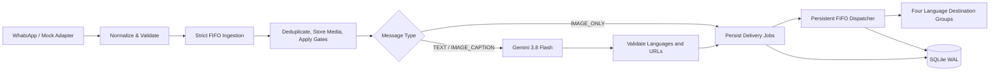

<p align="center">
  
</p>

<h1 align="center">
  SuaraPutra - Smart Multilingual Broadcasting
</h1>

<p align="center">
  <em>Smart Multilingual Broadcasting for WhatsApp Communities</em>
</p>

<p align="center">
  
  
  
  
  
</p>

SuaraPutra monitors one configured WhatsApp source group, identifies
announcement-worthy messages, translates them into four languages, and
delivers each version to its dedicated WhatsApp Community group.

The project is designed for Malaysian community communication, with support
for Malay, English, Simplified Chinese, and Tamil. It preserves original
images, protects URLs during translation, and keeps processing and delivery
state in SQLite so the service can recover safely after a restart.

> **Project status:** The backend core and mock/file-backed simulation baseline
> are implemented through Phase 6. Live WhatsApp pairing and physical SIM
> validation remain environment-dependent. The administrative dashboard is
> reserved for a later phase.

## Table of Contents

- [Why SuaraPutra](#why-suaraputra)
- [Core Features](#core-features)
- [Message Processing](#message-processing)
- [Architecture](#architecture)
- [Technology Stack](#technology-stack)
- [Getting Started](#getting-started)
- [Configuration](#configuration)
- [Run the Simulation](#run-the-simulation)
- [Testing and Verification](#testing-and-verification)
- [Project Status and Limitations](#project-status-and-limitations)
- [Documentation](#documentation)
- [Security and Data Handling](#security-and-data-handling)

## Why SuaraPutra

Community announcements are often written in one language even when the
audience uses several. Repeating and translating the same announcement
manually is slow, inconsistent, and difficult to audit.

SuaraPutra provides a controlled broadcast pipeline:

1. Receive a message from one trusted source group.
2. Process messages in chronological FIFO order.
3. Decide whether text is worth broadcasting.
4. Translate approved content into four target languages.
5. Deliver each language to its statically configured destination group.
6. Persist the result, delivery state, retry history, and telemetry.

## Core Features

| Feature | Description |
| --- | --- |
| Four-language broadcasting | Produces Malay (`ms`), English (`en`), Simplified Chinese (`zh-CN`), and Tamil (`ta`) versions. |
| Unified AI call | Uses one Gemini 3.8 Flash request for text worthiness scoring and translation. |
| Three message paths | Supports text, image with caption, and image-only messages. |
| Zero-OCR image handling | Preserves image bytes and translates captions only; image pixels are never OCR-processed. |
| URL preservation | Verifies that every source URL remains present in all translated outputs. |
| Strict FIFO processing | Prevents later messages from overtaking earlier messages during ingestion and destination dispatch. |
| Durable SQLite queue | Stores announcements, translations, delivery jobs, attempts, and recovery state. |
| Duplicate protection | Uses source-message deduplication and destination-aware idempotency keys. |
| Safe uncertain state | Ambiguous sends are held as `uncertain` instead of being blindly retried. |
| Mock-first transport | Runs without a WhatsApp account through a test adapter and file-backed outbox. |
| Operational guardrails | Includes bounded retries, media size limits, retention, kill switch, health data, and telemetry checkpoints. |

## Message Processing

### Text messages

Text is sent to Gemini with a worthiness score from `1.0` to `10.0`.
Messages below the configured threshold (`4.0` by default) are recorded as
ignored and do not create delivery jobs. Approved messages receive all four
language versions.

### Images with captions

The original image is written to local media storage and released from the
ingestion buffer. The caption is translated by Gemini, then paired with the
unchanged image for each destination.

### Images without captions

Image-only messages are forwarded directly to all four destinations without an
AI call. The original binary payload is preserved.

## Architecture



WhatsApp-specific details are isolated behind `IWhatsAppAdapter`. Core
ingestion, AI, validation, routing, persistence, and delivery modules do not
depend directly on Baileys. This allows the same pipeline to run with:

- `MockWhatsAppAdapter` for unit and integration tests.
- File-backed simulation for repeatable demonstrations.
- `BaileysWhatsAppAdapter` for configured live WhatsApp operation.

## Technology Stack

| Area | Technology |
| --- | --- |
| Runtime | Node.js 22 or newer |
| Language | TypeScript with strict type checking |
| WhatsApp transport | `@whiskeysockets/baileys` |
| AI provider | Google GenAI SDK with Gemini 3.8 Flash |
| Persistence | SQLite with `better-sqlite3` and WAL |
| Validation | Zod and deterministic TypeScript validators |
| Logging | Pino |
| Testing | Vitest |
| Deployment target | Google Cloud Compute Engine `e2-micro` |

## Getting Started

### Prerequisites

- Node.js `>=22.0.0`
- npm
- A Gemini API key for live AI processing
- WhatsApp group JIDs for live Baileys operation

Install dependencies:

```bash
npm install
```

Create a local `.env` file. At minimum, configure the source and destination
group JIDs:

```env
AI_API_KEY=your_gemini_api_key
WHATSAPP_SOURCE_GROUP_JID=source-group-id@g.us
WHATSAPP_MALAY_GROUP_JID=malay-group-id@g.us
WHATSAPP_ENGLISH_GROUP_JID=english-group-id@g.us
WHATSAPP_MANDARIN_GROUP_JID=mandarin-group-id@g.us
WHATSAPP_TAMIL_GROUP_JID=tamil-group-id@g.us
```

Run the application with the default configuration:

```bash
npm run dev
```

Build and run the compiled application:

```bash
npm run build
npm start
```

The default adapter is `mock`. Use `WHATSAPP_ADAPTER_MODE=baileys` only after
the authentication directory and trusted group mappings have been verified.

## Configuration

Important environment variables include:

| Variable | Default | Purpose |
| --- | --- | --- |
| `WHATSAPP_ADAPTER_MODE` | `mock` | Select `mock` or `baileys` transport. |
| `AI_PROVIDER` | `gemini` | Select `gemini` or deterministic `mock` AI. |
| `AI_MODEL` | `gemini-3.8-flash` | Gemini model name. |
| `ANNOUNCEMENT_SCORE_THRESHOLD` | `4.0` | Minimum text score for broadcast. |
| `MAX_CONCURRENT_INGESTIONS` | `1` | Enforces chronological FIFO processing. |
| `MAX_MEDIA_BYTES` | `10485760` | Maximum accepted media size, 10 MiB. |
| `DELIVERY_PACING_MS` | `1500` | Delay between outbound deliveries. |
| `DATA_RETENTION_DAYS` | `14` | Retention period for eligible local data. |
| `BROADCAST_KILL_SWITCH` | `false` | Stops new delivery claims without deleting queue state. |

All configuration is validated at startup. Keep `.env`, WhatsApp credentials,
private media, and operational databases outside Git.

## Run the Simulation

The repository includes synthetic inbox fixtures and a file-backed outbox.
The simulation can run with mock AI and does not require a WhatsApp account:

```bash
$env:AI_PROVIDER="mock"
$env:WHATSAPP_ADAPTER_MODE="mock"
npm run simulate:live
```

On Windows PowerShell, the generated report and group feeds are written under
`simulation/outbox/`. The directory is ignored by Git and may contain local
SQLite, media, and delivery artifacts.

To use another inbox fixture:

```bash
npm run simulate:live -- --inbox=simulation/inbox/messages.json
```

The simulation report includes announcement classification, translations,
delivery status, and CP01-CP09 telemetry checkpoints.

## Testing and Verification

Run the full automated test suite:

```bash
npm test
```

Run the type check:

```bash
npm run typecheck
```

Build the project:

```bash
npm run build
```

Run environment diagnostics:

```bash
npx tsx scripts/verify-environment.ts
```

The test suite covers configuration and telemetry, SQLite migrations,
WhatsApp mock behavior, ingestion and media handling, AI validation, delivery
queue ordering and recovery, Baileys error boundaries, and end-to-end
pipeline behavior.

## Project Status and Limitations

Implemented baseline capabilities:

- TypeScript backend composition root.
- Mock and Baileys WhatsApp adapters.
- SQLite persistence and migrations.
- FIFO ingestion and destination-aware delivery.
- Gemini translation and deterministic output validation.
- Image passthrough with no OCR.
- Retry, lease recovery, uncertain-send handling, retention, and telemetry.
- File-backed live simulation.

Current limitations:

- Live WhatsApp pairing depends on the dedicated operational account and
  physical SIM availability.
- The web administrative dashboard is not part of the current Phase 6 scope.
- Audio, video, documents, stickers, multi-source aggregation, and manual
  approval workflows are outside the current v1 scope.
- Gemini latency and availability depend on the external provider.
- Production deployment still requires environment-specific acceptance checks.

## Documentation

- [Architecture and technical source of truth](docs/architecture.md)
- [Project execution plan](docs/project-plan.md)
- [Architectural decisions](docs/DECISIONS.md)
- [Baileys integration specification](docs/BAILEYS_INTEGRATION_SPEC.md)
- [Operations runbook](docs/operations-runbook.md)
- [Development logs](docs/logs/dev/)
- [Test logs](docs/logs/test/)
- [Audits](docs/audits/)

## Security and Data Handling

- Never commit API keys, `.env` files, WhatsApp authentication files, private
  media, operational databases, or real group/message data.
- Treat inbound WhatsApp text as untrusted content, not as instructions.
- Keep routing static and configuration-controlled; AI output cannot select
  destination groups.
- Review `uncertain` jobs against delivery evidence before any manual
  reconciliation. They are not automatically resent.
- Use the kill switch before operational maintenance that must stop new
  delivery claims.
