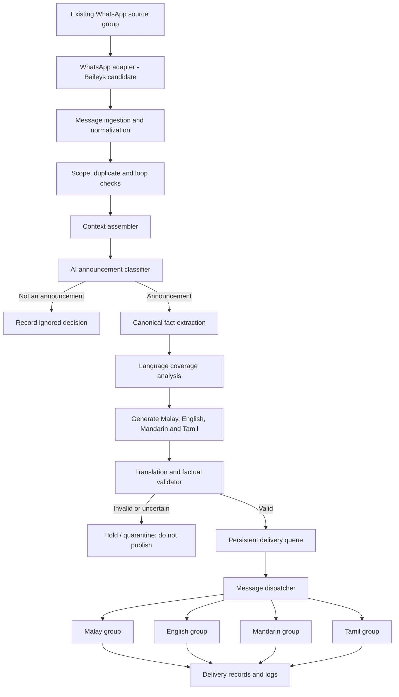

# WhatsApp Multilingual Announcement Automation

**Project planning and technical blueprint**  
**Document status:** Planning baseline — ready for implementation breakdown  
**Prepared:** 6 November 2026  
**Primary implementation language:** TypeScript  
**Initial WhatsApp integration candidate:** Baileys (unofficial; proof of concept required)  

---

## 1. Executive summary

The project will monitor a configured WhatsApp source group, determine whether incoming messages form an announcement, prepare complete versions in four configured languages, and automatically publish each version to its corresponding language group inside an **existing WhatsApp Community**.

The system will use a dedicated WhatsApp account registered on a new redONE SIM. The account will be added to the source group and destination language groups. A Node.js/TypeScript service will connect to WhatsApp through an unofficial linked-device library, with Baileys as the first candidate.

An AI model will be responsible for understanding the content and deciding whether it is an announcement. The translation process will be context-aware: an announcement may contain English and Malay in separate sections, or distribute important facts across multiple messages. The system must combine the information and ensure that every configured language group receives a complete, accurate announcement.

The first milestone is a WhatsApp integration proof of concept. Translation-model selection, VPS expenditure, and full implementation should wait until the proof of concept demonstrates that the existing Community's source and destination groups can be accessed reliably enough for testing.

> **Important platform and account risk:** Baileys is an unofficial WhatsApp Web client, not an approved WhatsApp API. WhatsApp's Messaging Guidelines and Help Center warn against unofficial clients and automated or bulk messaging, and accounts may be restricted or banned. A dedicated number separates this project from the personal WhatsApp account, but does not remove the risk or make the integration officially supported. This project must not attempt to evade WhatsApp enforcement or detection systems. See [Platform policy and risk](#15-whatsapp-platform-policy-and-risk).

## 2. Project objectives

### 2.1 Primary objectives

1. Automatically receive new messages from one configured WhatsApp source group.
2. Use AI to classify all received source-group messages and decide whether they are announcements worth distributing.
3. Understand announcements that contain multiple languages or spread information across related messages.
4. Produce a complete, natural announcement for each configured target language:
   - Malay (`ms`)
   - English (`en`)
   - Mandarin (`zh-CN`, Simplified Chinese by default)
   - Tamil (`ta`)
5. Automatically route each language version to its configured WhatsApp group.
6. Prevent duplicate processing and duplicate publication.
7. Record processing decisions, generated translations, and per-group delivery results.
8. Recover safely from temporary connection failures, process restarts, and individual delivery failures.
9. Develop locally first, then deploy to an inexpensive VPS for continuous operation.

### 2.2 Success criteria

The first production-capable release should:

- Correctly identify announcements without routinely broadcasting ordinary conversation.
- Preserve all important source facts, including dates, times, venues, names, amounts, deadlines, and URLs.
- Produce complete versions in all four configured languages.
- Avoid unnecessary duplication where the source already contains a complete version in a target language.
- Send each output to the correct configured group.
- Avoid duplicate sends when an event is delivered more than once or the service restarts.
- Expose failed, skipped, and completed work through structured logs and persistent records.
- Reconnect and resume pending work without silently losing announcements.

### 2.3 Non-goals for the first release

The first release will not attempt to:

- Translate or redistribute every type of WhatsApp content, such as images, videos, voice notes, stickers, documents, or polls.
- Monitor multiple source groups.
- Publish to arbitrary groups outside the configured Community.
- Provide a public-facing translation dashboard unless needed for operational monitoring.
- Train or fine-tune a custom language model.
- Use a complex microservices architecture, Kubernetes, or Redis without a demonstrated need.
- Evade WhatsApp rate limits, anti-abuse controls, or platform enforcement.

The initial functional scope is **text announcements**. Media and document support can be considered after the text workflow is reliable.

## 3. Confirmed project decisions

| Area | Confirmed decision |
|---|---|
| WhatsApp environment | Preserve and use the existing WhatsApp Community |
| Automation account | A new, dedicated WhatsApp number |
| SIM provider | redONE; user plans to purchase a low-cost SIM |
| Personal WhatsApp account | Keep separate from the automation account |
| Integration approach | Investigate an unofficial linked-device integration; Baileys is the initial candidate |
| Source monitoring | Process all new messages received from the configured source group; AI decides whether they are announcements |
| Target languages | Malay, English, Mandarin, and Tamil |
| Translation strategy | Hybrid: reuse/consolidate complete source-language content where suitable, but ensure every destination receives a complete version |
| Approval workflow | Fully automated for high-confidence announcements; no routine manual approval step |
| Development | Local development and proof of concept first |
| Production hosting | Inexpensive VPS after local validation |
| Backend | Node.js + TypeScript |
| Initial database | SQLite; reassess PostgreSQL only if scale or concurrency warrants it |
| Validation | Zod or an equivalent runtime schema validator |
| AI model | Small multilingual model to be selected through an evaluation, not assumed in advance |

## 4. Language and translation requirements

### 4.1 Configured language destinations

The initial language configuration is:

| Language | Code | Default writing convention | Destination |
|---|---|---|---|
| Malay | `ms` | Natural Malaysian Malay; use a suitable formal/friendly announcement tone | Configured Malay group JID |
| English | `en` | Clear, natural English; preserve official names and terminology | Configured English group JID |
| Mandarin | `zh-CN` | Simplified Chinese by default; retain standard names/acronyms where appropriate | Configured Mandarin group JID |
| Tamil | `ta` | Natural, readable written Tamil suitable for a Malaysian community announcement | Configured Tamil group JID |

The language codes and writing conventions should be configuration values, not hard-coded into the translation logic. If the community later prefers Traditional Chinese or a different tone, that should be configurable without rewriting the application.

### 4.2 Meaning-first translation

The system must **understand the full announcement before producing target-language versions**. It must not translate each source-language block independently and concatenate the results.

Example source announcement:

> Registration for the AI Workshop is now open!  
> Date: 15 November 2026  
> Time: 9:00 AM – 12:00 PM  
> Venue: FSKTM, UPM  
>
> Pendaftaran ditutup pada 12 November 2026.  
> Registration link: https://example.invalid/register

In this example, the event information is in English while the registration deadline is in Malay. Every target-language output must include both sets of facts.

### 4.3 Hybrid language-coverage rules

For each announcement, the AI should assess how much of the complete information is already available in each target language.

| Source coverage for a target language | Required behaviour |
|---|---|
| Complete, accurate, and reasonably clear | Reuse or lightly normalize the existing version; do not needlessly retranslate it |
| Partial | Combine the existing target-language text with facts supplied in other languages, then produce one complete version |
| Missing | Generate a complete translation from the canonical announcement facts |
| Conflicting or ambiguous | Do not guess; mark the announcement for safe handling rather than publishing a potentially incorrect version |

**Completeness is measured against the announcement's facts, not by the percentage of the source text written in that language.** A language section is not complete merely because it is long.

Every configured destination must receive a complete version when the announcement passes validation. Do not send a partial translation simply because the source already contains some text in that language.

### 4.4 Translation quality rules

Translations must:

- Preserve the meaning, intent, tone, and important instructions of the source.
- Use natural language rather than literal word-for-word translation.
- Preserve proper names, organization names, course codes, official acronyms, email addresses, phone numbers, URLs, and identifiers unless a glossary explicitly provides an approved localized form.
- Preserve dates, times, durations, prices, quantities, percentages, deadlines, addresses, and venue details exactly in meaning.
- Avoid inventing facts, clarifying details, eligibility rules, or promises not supported by the source.
- Keep formatting useful for WhatsApp: readable headings, short paragraphs, lists, and appropriate emoji where present in the source.
- Avoid duplicating an event detail merely because it appeared in more than one source language.
- Avoid adding commentary such as “AI translation” unless explicitly configured.

### 4.5 Glossary and style configuration

Maintain a configurable glossary for recurring institutional vocabulary. A glossary entry may contain:

- Canonical concept or source term.
- Preferred Malay equivalent.
- Preferred English wording.
- Preferred Mandarin equivalent.
- Preferred Tamil equivalent.
- Terms that must remain unchanged.
- Optional context or usage notes.

Examples of terms to consider adding after collecting real announcements include faculty names, student bodies, academic roles, registration terminology, course labels, and event names. Do not invent official translations; confirm preferred terminology with the relevant organization.

## 5. End-to-end processing workflow

1. **Receive:** The WhatsApp adapter receives a new message event from the configured source group.
2. **Normalize:** Convert the WhatsApp event into an internal message representation containing chat JID, message ID, sender JID, timestamp, text, quoted-message reference, and relevant metadata.
3. **Scope check:** Confirm that the message belongs to the configured source group. Ignore all other chats.
4. **Loop and duplicate check:** Ignore the bot's own outgoing messages and any message ID/content event already processed.
5. **Context assembly:** Retrieve the quoted message and only the relevant recent messages needed to understand a multi-part announcement.
6. **AI classification:** Determine whether the message or assembled message group represents an announcement worth distributing.
7. **Announcement decision:** Ignore ordinary conversation. Continue only when the classifier returns a sufficiently confident announcement decision. Ambiguous cases must not be broadcast automatically.
8. **Fact extraction:** Identify source languages, announcement type, key facts, links, instructions, entities, and possible conflicts. Produce a structured canonical representation.
9. **Language coverage analysis:** Evaluate whether each of the four target languages is complete, partial, missing, or conflicting.
10. **Translation generation:** Produce one complete output for each configured language using the canonical facts, glossary, and style rules.
11. **Validation:** Check output schema, completeness, factual consistency, critical values, URLs, and destination mapping.
12. **Queue:** Create one persistent delivery job per destination group.
13. **Dispatch:** Send each valid output to its configured group.
14. **Confirm and record:** Record the outgoing message ID and per-destination result where available. Treat an ambiguous send result as uncertain rather than blindly retrying.
15. **Recovery:** Retry eligible failures safely and resume unfinished jobs after a restart.

## 6. Proposed system architecture



### 6.1 Main components

| Component | Responsibility |
|---|---|
| WhatsApp adapter | Connects the dedicated account, receives message events, resolves group metadata, sends messages, and reports connection state |
| Message normalizer | Converts provider-specific events into an internal, provider-independent schema |
| Scope and deduplication filter | Restricts processing to the configured source group and prevents repeated work |
| Context assembler | Adds relevant quoted/replied-to content and carefully bounded recent context |
| Announcement classifier | Determines whether content is an announcement worth distributing |
| Fact extractor | Produces canonical structured information from multilingual source content |
| Language coverage analyzer | Determines complete, partial, missing, or conflicting language coverage |
| Translation generator | Produces complete Malay, English, Mandarin, and Tamil versions |
| Validator | Checks structure, factual consistency, completeness, and protected values |
| Message router | Maps each language code to the correct destination group JID |
| Persistent queue and dispatcher | Tracks jobs, sends messages, handles retries, and prevents duplicate delivery |
| Database and logging | Stores processing state, outputs, and operational history |
| Configuration | Stores group mappings, languages, glossary, thresholds, and model settings |

### 6.2 Separation of concerns

The translation engine must not depend directly on Baileys. It should accept an internal announcement object and return structured language outputs. The WhatsApp adapter is responsible only for transport.

This separation allows the WhatsApp integration to be replaced or modified without rewriting classification, translation, validation, or routing logic.

## 7. AI design

### 7.1 Model-selection strategy

Use a small multilingual instruction-following model, selected through practical evaluation. Do not select it solely by parameter count, marketing claims, or general benchmark scores.

The model must be evaluated on mixed-language comprehension and generation quality for **Malay, English, Mandarin, and Tamil**. In particular, it must handle messages that contain more than one language and announcements where important facts are distributed across languages or related messages.

The application should use a provider/model adapter so the model provider can be changed without rewriting the business logic.

### 7.2 Proposed AI stages

**Stage A — Announcement classification**

Input:
- Current message text.
- Relevant quoted message, if any.
- A small, bounded amount of relevant recent source-group context.
- Classification instructions and supported announcement categories.

Output:
- `announcement`, `not_announcement`, or `uncertain`.
- Confidence or calibrated decision score.
- Short classification reason.
- Message IDs used as context.
- Suggested announcement category, if applicable.

Possible announcement categories include event notices, registration announcements, deadlines, schedule changes, cancellations, urgent administrative notices, opportunities, and official reminders.

Examples normally classified as `not_announcement` include casual conversation, personal questions, reactions, greetings, and ordinary thank-you messages. Context may change a decision: a short “Registration closes tomorrow” message may be an announcement even though it is not a complete standalone paragraph.

**Stage B — Canonical fact extraction**

Input:
- Candidate announcement text or assembled message set.
- Relevant context.
- Glossary and organization-specific rules.

Output:
- Announcement type and subject.
- Source languages detected.
- Atomic facts and their source locations.
- Dates, times, venues, names, URLs, quantities, and instructions.
- Language-coverage assessment.
- Conflicts, ambiguities, or missing critical information.

**Stage C — Multilingual generation**

Generate complete output objects for `ms`, `en`, `zh-CN`, and `ta`. The model may reuse a source-language version when it is already complete and accurate, or consolidate and rewrite it when information is scattered or incomplete.

**Stage D — Validation**

Use both deterministic code and AI-assisted checks where useful. Critical fields such as dates, times, links, phone numbers, amounts, and identifiers should be checked against the canonical facts using code wherever possible.

A model saying that its own translation is correct is not sufficient validation.

### 7.3 Classification confidence and automatic handling

The system is fully automated for normal high-confidence announcements, but it must fail safely.

Recommended decision policy:

| Classifier result | System behaviour |
|---|---|
| High-confidence announcement | Continue to extraction and translation |
| Medium-confidence or incomplete context | Hold for further context or classify as uncertain; do not broadcast immediately |
| Not an announcement | Record the decision and ignore |
| Conflicting or potentially harmful/ambiguous content | Quarantine; do not publish |

Confidence thresholds must be calibrated using a labelled test set. Do not invent a universal numeric threshold before evaluation. A high false-positive rate is especially costly because it causes irrelevant messages to be broadcast into four groups.

No routine manual approval is planned. A later optional admin review or notification mechanism may be added for quarantined items, but it is not part of the normal automated flow.

### 7.4 Context assembly and multi-message announcements

Some announcements arrive as multiple consecutive messages. The context assembler should:

- Include the quoted/replied-to message when available.
- Retrieve a bounded number of recent messages from the same source group.
- Prefer messages from the same sender and a configurable short time window when considering a multi-message announcement.
- Avoid combining unrelated conversations merely because they occurred close together.
- Preserve the individual source message IDs used to form an announcement.
- Avoid reprocessing the same assembled announcement when a later related message arrives.

A configurable short aggregation window may be tested during development. Its duration should be chosen from real examples, not fixed without evidence.

### 7.5 Prompt and data safety

Messages received from WhatsApp are untrusted content. They must be treated as data, not instructions to the AI system.

The model must never be allowed to:
- Change destination group IDs or routing rules.
- Override system prompts, developer instructions, or security settings based on message content.
- Execute links, code, commands, or external actions found in an announcement.
- Reveal credentials, session data, or internal configuration.
- Invent facts when the source is incomplete.

Keep routing decisions and allowed group JIDs in application configuration, not in model-generated output.

## 8. Canonical announcement data contract

The exact schema will be finalized during implementation. The following is an illustrative contract, not production code:

```json
{
  "announcementType": "event",
  "subject": "AI Workshop",
  "sourceMessageIds": ["SOURCE_MESSAGE_ID_1", "SOURCE_MESSAGE_ID_2"],
  "sourceLanguages": ["en", "ms"],
  "facts": [
    {
      "key": "event_date",
      "value": "2026-11-15",
      "sourceLanguage": "en",
      "critical": true
    },
    {
      "key": "event_time",
      "value": "09:00-12:00",
      "sourceLanguage": "en",
      "critical": true
    },
    {
      "key": "venue",
      "value": "FSKTM, UPM",
      "sourceLanguage": "en",
      "critical": true
    },
    {
      "key": "registration_deadline",
      "value": "2026-11-12",
      "sourceLanguage": "ms",
      "critical": true
    },
    {
      "key": "registration_url",
      "value": "https://example.invalid/register",
      "sourceLanguage": "en",
      "critical": true
    }
  ],
  "languageCoverage": {
    "ms": "partial",
    "en": "partial",
    "zh-CN": "missing",
    "ta": "missing"
  },
  "conflicts": [],
  "requiresHold": false
}
```

The final schema should be validated at runtime using Zod or an equivalent validator. Dates should be represented in a canonical form internally, while rendered date formats may be localized consistently in each language. The underlying date must not change during localization.

## 9. Message routing and delivery

### 9.1 Group configuration

Use WhatsApp group JIDs as stable routing identifiers. Do not route by display name alone, because names can be changed or duplicated.

Illustrative configuration:

```ts
export const communityConfig = {
  sourceGroupJid: "SOURCE_GROUP_JID",
  destinations: {
    ms: "MALAY_GROUP_JID",
    en: "ENGLISH_GROUP_JID",
    "zh-CN": "MANDARIN_GROUP_JID",
    ta: "TAMIL_GROUP_JID"
  }
};
```

Actual JIDs must be collected during the integration proof of concept and stored securely in configuration. The model must never generate or modify these identifiers.

### 9.2 Per-language delivery jobs

Create one job for each configured destination. Each job should contain:

- Announcement ID.
- Language code.
- Target group JID from trusted configuration.
- Final validated message text.
- Idempotency key.
- Status and attempt count.
- Created, attempted, and completed timestamps.
- WhatsApp outgoing message ID when available.
- Last error and retry eligibility.

A failure sending to one destination must not invalidate successful deliveries to other destinations.

### 9.3 Delivery states

Recommended states:

`pending` → `sending` → `sent`

Failure and recovery states may include:

- `retry_wait`
- `failed_permanent`
- `uncertain`
- `cancelled`

If a send request times out after the remote side may have accepted it, the job should be marked `uncertain` until reconciled. Blindly retrying an uncertain send could create a duplicate announcement.

### 9.4 Message formatting

Preserve useful source formatting and provide consistent output structure across languages. Avoid adding large decorative headers or redundant descriptions. Keep URLs intact and ensure the final text remains within WhatsApp's supported message limits.

For the initial text-only release, an announcement should normally be published as one message per destination. If a message must be split because of length limits, preserve a stable announcement reference and part numbering so the parts remain understandable.

## 10. Data storage design

SQLite is suitable for the initial single-instance, low-volume deployment. Use migrations and transactions from the beginning. Reassess PostgreSQL if multiple worker instances, higher concurrency, operational requirements, or database size make SQLite unsuitable.

Proposed entities/tables:

| Table | Important fields | Purpose |
|---|---|---|
| `group_config` | `group_jid`, `role`, `language_code`, `community_jid`, `enabled` | Source and destination mapping |
| `source_messages` | `chat_jid`, `message_id`, `sender_jid`, `timestamp`, `text`, `content_hash`, `quoted_message_id` | Ingested source message records |
| `announcements` | `id`, `classification`, `canonical_facts_json`, `status`, `created_at` | Announcement-level processing record |
| `announcement_sources` | `announcement_id`, `source_message_id` | Links one announcement to one or more messages |
| `translations` | `announcement_id`, `language_code`, `content`, `coverage_strategy`, `validation_status` | Generated or reused language versions |
| `delivery_jobs` | `announcement_id`, `language_code`, `target_group_jid`, `status`, `attempts`, `idempotency_key`, `outgoing_message_id` | Per-destination delivery state |
| `glossary_terms` | `term_key`, `language_code`, `preferred_translation`, `notes` | Approved translation vocabulary |
| `prompt_versions` | `name`, `version`, `content_hash`, `created_at` | Reproducibility for prompt changes |
| `event_logs` | `event_type`, `related_id`, `level`, `details_json`, `created_at` | Operational audit trail |

### 10.1 Persistence principles

- Enforce a unique constraint on `(chat_jid, message_id)` for source-message deduplication.
- Enforce a unique idempotency key for each announcement/destination pair.
- Use transactions when creating an announcement, its translations, and its delivery jobs.
- Persist a job before attempting to send it.
- Do not rely on in-memory arrays or timers as the only record of pending work.
- Store timestamps in UTC and convert them for display as needed.
- Keep message content only as long as operationally necessary; define a retention policy before production.

## 11. Reliability and error handling

### 11.1 Connection recovery

- Detect WhatsApp socket connection state changes.
- Persist the linked-device authentication state securely.
- Reconnect after transient disconnections with bounded backoff.
- Avoid creating multiple concurrent WhatsApp sessions for the same account.
- Verify group membership and send permissions after reconnection.
- Alert through logs or an optional operational notification if the session repeatedly fails.

### 11.2 Processing recovery

- Persist the source event before beginning long-running AI calls.
- Use explicit processing states so interrupted work can resume.
- Reclaim stale jobs after a process restart using leases or timestamps.
- Bound retry counts and retry only errors that are plausibly transient.
- Store model errors separately from WhatsApp delivery errors.
- Never silently discard a message because the AI provider or WhatsApp connection is unavailable.

### 11.3 Duplicate prevention

Use multiple protections:

1. Source-message ID uniqueness.
2. Stable announcement identity derived from source message IDs.
3. A content fingerprint as a secondary similarity signal, not the sole identity mechanism.
4. Unique delivery idempotency key per announcement and destination.
5. Outgoing message ID recording when the adapter returns one.
6. Loop prevention for messages sent by the automation account.

A content fingerprint alone must not suppress two genuinely distinct announcements that happen to have identical wording.

### 11.4 Rate and failure handling

The system should send only the intended announcement messages to the configured groups. It must not implement evasion techniques such as randomized anti-detection behaviour, account rotation, proxy rotation, or attempts to bypass platform enforcement. Platform restrictions must be respected; if an integration becomes restricted or unsupported, pause the automation rather than attempting to circumvent the restriction.

## 12. Privacy and security

### 12.1 Dedicated account

- Use the dedicated redONE number exclusively for the automation.
- Keep the personal WhatsApp account separate.
- Maintain access to the SIM/number for verification and account recovery.
- Add the dedicated account only to the groups necessary for the project.
- Grant the minimum group privileges required to post.

A dedicated account reduces the impact on the personal account but does not prevent the dedicated account from being restricted or banned.

### 12.2 Linked-device credentials

Baileys authentication credentials provide access to the linked WhatsApp session and must be treated as secrets.

- Never commit authentication files or session keys to Git.
- Add credential paths to `.gitignore`.
- Restrict filesystem permissions on local and VPS environments.
- Use encrypted storage or an appropriately protected secret store for production.
- Never print credentials, QR pairing payloads, or session tokens in application logs.
- Define a secure backup and revocation procedure.

### 12.3 AI provider and message privacy

This design uses AI to decide whether **all** messages in the configured source group are announcements. If classification uses an external model API, message text and any context included in the request will leave the WhatsApp client and be processed by that provider.

Before enabling an external model on a real group:

- Inform the relevant group/community administrators and participants that messages may be processed by an automated system.
- Confirm that the group has an appropriate basis and permission for this processing.
- Review the model provider's data retention, training, logging, and regional processing terms.
- Send only the minimum message/context needed for classification.
- Consider a locally hosted classifier if privacy requirements or provider terms make external classification unsuitable.
- Avoid sending unrelated chat history to the translation model.

The project should not claim that WhatsApp end-to-end encryption protects message content after the linked client has received and forwarded that content to an external AI provider.

### 12.4 Application security

- Keep API keys in environment variables or a secret manager, never in source code.
- Validate all inbound data and AI outputs.
- Treat message content, URLs, quoted text, and attachments as untrusted input.
- Do not fetch URLs automatically as part of announcement processing.
- Restrict admin configuration changes to an authorized operator.
- Use secure VPS access, firewall rules, operating-system updates, and least-privilege service accounts.

## 13. Proposed repository structure

Initial structure proposal:

```text
SuaraPutra_Smart_Multilingual_Broadcasting/
├── .github/
│   ├── agents/
│   │   ├── developer.agent.md
│   │   ├── web_developer.agent.md
│   │   └── tester.agent.md
│   └── skills/
│       ├── ai-translation-engine/
│       │   └── SKILL.md
│       ├── backend-architecture/
│       │   └── SKILL.md
│       ├── database-management/
│       │   └── SKILL.md
│       ├── documentation-workflow/
│       │   └── SKILL.md
│       ├── git-scope-and-commits/
│       │   └── SKILL.md
│       ├── project-context/
│       │   └── SKILL.md
│       ├── queue-and-reliability/
│       │   └── SKILL.md
│       ├── testing-and-qa/
│       │   └── SKILL.md
│       ├── typescript-node/
│       │   └── SKILL.md
│       ├── whatsapp-baileys/
│       │   └── SKILL.md
│       └── web-application/
│           └── SKILL.md
├── docs/
│   ├── project-plan.md
|   ├── BAILEYS_INTEGRATION_SPEC.md
│   ├── architecture.md
│   └── operations-runbook.md
├── src/
│   ├── app.ts
│   ├── config/
│   │   ├── env.ts
│   │   ├── groups.ts
│   │   └── languages.ts
│   ├── whatsapp/
│   │   ├── adapter.ts
│   │   ├── baileys-client.ts
│   │   ├── event-normalizer.ts
│   │   └── group-metadata.ts
│   ├── ingestion/
│   │   ├── message-ingestor.ts
│   │   ├── deduplicator.ts
│   │   └── context-assembler.ts
│   ├── ai/
│   │   ├── model-provider.ts
│   │   ├── classifier.ts
│   │   ├── fact-extractor.ts
│   │   ├── language-coverage.ts
│   │   ├── translator.ts
│   │   ├── prompts/
│   │   └── schemas/
│   ├── validation/
│   │   ├── translation-validator.ts
│   │   └── protected-values.ts
│   ├── routing/
│   │   └── message-router.ts
│   ├── delivery/
│   │   ├── queue.ts
│   │   ├── dispatcher.ts
│   │   └── retry-policy.ts
│   ├── database/
│   │   ├── client.ts
│   │   ├── migrations/
│   │   └── repositories/
│   ├── observability/
│   │   ├── logger.ts
│   │   └── health.ts
│   └── shared/
│       ├── types.ts
│       └── errors.ts
├── tests/
│   ├── unit/
│   ├── integration/
│   ├── fixtures/
│   └── evaluation/
├── data/                 # Local database; never commit production data
├── .env.example
├── .gitignore
├── package.json
├── tsconfig.json
└── README.md
```

The exact structure may be adjusted during implementation, but module boundaries should remain clear.

## 14. Development milestones and acceptance criteria

### M0 — WhatsApp integration proof of concept

**Goal:** Prove that the selected linked-device integration can interact with the actual existing Community sufficiently for the intended workflow.

Tasks:
- Purchase and register the dedicated SIM/account.
- Add the account to the configured source and destination groups.
- Pair the account with a local TypeScript application.
- Receive and log a test message from the source group.
- Identify the source group JID.
- Retrieve and inspect relevant group metadata.
- Identify the four destination group JIDs.
- Send a controlled test message to each destination group.
- Confirm that the bot account has the necessary posting permissions.
- Test disconnect/reconnect and credential persistence.
- Confirm that the library's current release, runtime requirements, license, and Community behaviour are suitable for continued testing.

**Acceptance criteria:**
- The bot can receive a new source-group message in a repeatable test.
- The application can distinguish the configured source group from other chats.
- The four destination group IDs are known and verified.
- A controlled test message can be sent to each destination group.
- The process can reconnect without manual re-pairing in the tested conditions.
- No critical Community functionality is assumed merely from the presence of metadata fields; it is verified in the actual environment.

**Gate:** If M0 fails, pause. Evaluate a different integration approach or revisit feasibility before building the rest of the system.

### M1 — AI announcement classification

Tasks:
- Define announcement categories and negative examples.
- Assemble a labelled dataset from historical/sample messages.
- Implement classifier output schema.
- Calibrate confidence thresholds.
- Add context assembly for quoted messages and multi-message announcements.
- Record `announcement`, `not_announcement`, and `uncertain` decisions.

**Acceptance criteria:**
- Classifier identifies representative announcements across the test set.
- Ordinary conversation is not routinely classified as an announcement.
- Short but meaningful follow-up notices can be recognized with relevant context.
- Uncertain cases are held rather than broadcast.

### M2 — Context-aware multilingual translation

Tasks:
- Define canonical announcement schema.
- Define glossary and language style configuration for Malay, English, Mandarin, and Tamil.
- Implement fact extraction and language coverage analysis.
- Implement hybrid translation rules.
- Evaluate candidate models and provider options.
- Implement structured generation and protected-value validation.

**Acceptance criteria:**
- Every valid announcement produces four complete versions.
- Mixed-language source facts are combined correctly.
- Complete source-language versions are reused or sensibly consolidated instead of unnecessarily retranslated.
- Dates, times, names, amounts, URLs, and other protected values remain accurate.
- Outputs are natural and understandable to fluent readers of all four languages.

### M3 — Automated distribution

Tasks:
- Implement language-to-group routing.
- Create one persistent delivery job per destination.
- Implement message formatting and sending.
- Record send results and outgoing message IDs.
- Add duplicate-send protection.

**Acceptance criteria:**
- Each language version reaches only its configured destination.
- One destination failure does not cause successful destinations to be resent.
- Duplicate source events do not cause duplicate publication.
- Every delivery has a recorded state.

### M4 — Reliability and recovery

Tasks:
- Add persistent queue recovery.
- Add bounded retry policies.
- Handle uncertain send outcomes.
- Test process termination during classification, generation, and dispatch.
- Add health checks and operational logs.
- Define retention and backup routines.

**Acceptance criteria:**
- Restarting the application does not lose persisted pending work.
- Successful deliveries are not resent during recovery.
- Transient failures can be retried safely.
- Uncertain outcomes are visible and not blindly duplicated.

### M5 — VPS deployment

Tasks:
- Select a low-cost VPS based on measured memory, CPU, storage, and network requirements.
- Configure runtime, process supervision, firewall, and secure SSH access.
- Move secrets and authentication credentials securely.
- Configure logs, health checks, backups, and restart policy.
- Test reboot and recovery.

**Acceptance criteria:**
- Service runs continuously under process supervision.
- Service recovers after a VPS reboot.
- Credentials and database files are not publicly exposed.
- Operational health and delivery failures can be inspected.

## 15. WhatsApp platform policy and risk

This project deliberately preserves the existing WhatsApp Community, but the likely linked-device approach is unofficial.

Relevant current references checked on 6 November 2026:

- WhatsApp Messaging Guidelines, last updated 23 September 2026: https://www.whatsapp.com/legal/messaging-guidelines
- WhatsApp Help Center, “How to use WhatsApp responsibly”: https://faq.whatsapp.com/361005896189245/
- WhatsApp Help Center, “About restricted accounts”: https://faq.whatsapp.com/717472490411581/
- Baileys GitHub repository: https://github.com/WhiskeySockets/Baileys
- Baileys documentation: https://baileys.wiki/
- Baileys GroupMetadata type: https://github.com/WhiskeySockets/Baileys/blob/master/src/Types/GroupMetadata.ts
- Baileys npm package: https://www.npmjs.com/package/baileys

The published WhatsApp guidelines apply to group chats and Communities and prohibit unofficial clients, bulk messaging, auto-messaging, and automation used to harm WhatsApp or its users. WhatsApp's Help Center also warns that automated or bulk messaging may lead to account bans. Baileys is not affiliated with or endorsed by WhatsApp; its maintainers discourage spam, bulk, and automated messaging usage.

Therefore:

1. This architecture is a technical exploration, not a claim that the proposed integration is officially permitted.
2. The dedicated number does not remove the platform-policy risk.
3. Do not use modified WhatsApp clients, account rotation, proxy rotation, anti-detection methods, or other techniques intended to bypass enforcement.
4. If the account is restricted, the integration is blocked, or platform requirements change, pause the automation and reassess. Do not attempt to evade the restriction.
5. Recheck the current policy and library documentation immediately before implementation and again before production deployment.
6. Keep the automation limited to the intended community announcements, and make sure administrators and participants understand the automation and data-processing arrangement.

### 15.1 Baileys compatibility notes

Baileys exposes group metadata fields such as `linkedParent`, `isCommunity`, and `isCommunityAnnounce` in its type definitions. These fields may help inspect Community relationships, but their presence does not prove that every Community operation is supported or stable. Verify actual behaviour with the existing Community during M0.

The repository and npm package currently warn about breaking changes in the 7.0.0 line. The npm page surfaced `7.0.0-rc14` during the research for this document. Do not copy a version number from this planning document into production blindly. At M0, inspect the latest stable/release status, migration guide, Node.js requirements, issue tracker, and package integrity; then pin the exact tested version in the lockfile.

## 16. Testing and model evaluation strategy

### 16.1 Build an evaluation dataset

Collect approximately 30–50 representative announcements and ordinary messages before selecting the model. Include real or carefully anonymized examples such as:

- English-only announcements.
- Malay-only announcements.
- Mandarin-only announcements.
- Tamil-only announcements.
- English + Malay mixed announcements.
- Announcements mixing three or four languages.
- Announcements where different languages contain different facts.
- Announcements split across multiple consecutive messages.
- Short reminders and urgent schedule changes.
- Ordinary conversation that should be ignored.
- Ambiguous or contradictory messages that should be held.

The dataset should include fluent review by people competent in the target languages. Do not use model self-evaluation as the only measure of translation quality.

### 16.2 Metrics

| Area | Metric or review method |
|---|---|
| Announcement detection | Precision, recall, and false-positive rate |
| Fact extraction | Field-level accuracy for dates, times, venues, names, links, and amounts |
| Language coverage | Percentage of required facts present in each output |
| Translation quality | Fluent human review for meaning, naturalness, tone, and terminology |
| Duplicate control | Duplicate publication rate in replay/restart tests |
| Routing | Correct destination mapping in every integration test |
| Reliability | Recovery rate after simulated connection and process failures |
| Cost | Cost per accepted announcement across all four languages |

False positives deserve special attention because an ordinary conversation being distributed to four groups is disruptive. Critical fact errors should be treated as release-blocking defects.

### 16.3 Required edge cases

- Same source message event received twice.
- Two different announcements with identical wording.
- A related follow-up message arrives after the initial message was processed.
- A message quotes an earlier announcement.
- The original contains conflicting dates in two languages.
- URL contains punctuation or appears more than once.
- Model returns malformed JSON or omits one target language.
- AI provider times out after accepting a request.
- WhatsApp disconnects before dispatch.
- WhatsApp send times out after the remote side may have accepted the message.
- One destination group has posting restrictions.
- Bot receives its own outgoing message event.
- VPS restarts while jobs are pending.

## 17. Local development and deployment approach

### 17.1 Local development

- Develop on the user's computer using Node.js and TypeScript.
- Use a separate development configuration and SQLite database.
- Keep `.env`, WhatsApp authentication files, test message data, and local databases out of Git.
- Begin with the Baileys integration proof of concept.
- Use mock adapters for translation and delivery tests where a real WhatsApp session is not required.
- Test model behaviour using the evaluation dataset before enabling automated publication.

### 17.2 VPS deployment

A small VPS is the intended production environment, subject to measured resource requirements.

Expected production needs:
- Persistent storage for SQLite and WhatsApp credentials.
- A supervised Node.js process.
- Reliable outbound network access.
- Firewall and secure remote administration.
- Database and credential backup procedures.
- Logs with rotation and retention limits.
- Health monitoring for WhatsApp connection state, AI provider errors, and pending delivery jobs.

Do not choose a VPS size or monthly budget until the chosen AI hosting/API model and Baileys memory usage have been measured. If the model is accessed by API, the VPS may not need GPU resources.

## 18. Open decisions for implementation

The project direction is established, but these choices should be settled with evidence during the relevant milestone:

1. **Baileys release:** exact tested version and compatibility with the existing Community.
2. **Model/provider:** API-hosted small multilingual model versus locally hosted model, based on privacy, quality, latency, and cost.
3. **Classification location:** external model API versus local classifier, considering that every source-group message is evaluated.
4. **Confidence thresholds:** choose from a labelled evaluation set.
5. **Context window:** decide how many recent messages and what time window are appropriate for multi-message announcements.
6. **Glossary:** obtain approved translations for recurring organization-specific terms.
7. **Retention:** decide how long original source text, context, translations, and logs should be retained.
8. **Operational alerts:** choose whether failures should be reported through a separate channel and who receives them.
9. **VPS:** choose provider and size after measuring the working application.
10. **Privacy notice and authorization:** confirm the appropriate notice/permission with Community administrators and participants before real message processing.

These open decisions do not prevent starting M0, but privacy, platform-policy, and integration feasibility must be considered before production operation.

## 19. Definition of done for the first usable release

The first usable release is complete when:

- The dedicated account is connected in the tested environment.
- The application receives all new messages from the configured source group.
- The AI distinguishes announcements from ordinary conversation with acceptable measured precision.
- Related multilingual message content is assembled correctly when needed.
- The system extracts canonical facts and identifies source-language coverage.
- Every accepted announcement produces complete Malay, English, Mandarin, and Tamil outputs.
- Hybrid handling avoids unnecessary retranslation while never leaving a destination with partial content.
- Critical factual values pass deterministic validation.
- Each language output is routed to the correct configured group.
- Duplicate and loop prevention are tested.
- Delivery states, failures, and retries are persisted.
- Restart/recovery tests pass.
- Privacy, credential handling, and platform-policy risks have been reviewed and documented.

---

## Appendix A — Initial environment variables (illustrative)

```dotenv
NODE_ENV=development
LOG_LEVEL=info
DATABASE_URL=./data/automation.sqlite

WHATSAPP_SOURCE_GROUP_JID=
WHATSAPP_MALAY_GROUP_JID=
WHATSAPP_ENGLISH_GROUP_JID=
WHATSAPP_MANDARIN_GROUP_JID=
WHATSAPP_TAMIL_GROUP_JID=
WHATSAPP_AUTH_DIR=./private/whatsapp-auth

AI_PROVIDER=
AI_MODEL=
AI_API_KEY=
AI_CLASSIFIER_MODE=api

CLASSIFIER_THRESHOLD_HIGH=
CLASSIFIER_THRESHOLD_MEDIUM=
CONTEXT_MAX_MESSAGES=
CONTEXT_WINDOW_SECONDS=

DATA_RETENTION_DAYS=
```

These names are placeholders. Secrets must not be placed in a committed `.env` file. The committed `.env.example` should contain empty values or safe examples only.

## Appendix B — Initial operational checklist

### Before connecting WhatsApp
- [ ] Review current WhatsApp policies and Baileys documentation.
- [ ] Purchase and register the dedicated redONE SIM/account.
- [ ] Confirm the number can receive verification and recovery messages.
- [ ] Add the account to the source and four destination groups.
- [ ] Confirm required group posting permissions.
- [ ] Inform relevant administrators/participants about the proposed automation and data handling.

### Before enabling AI processing
- [ ] Select a model/provider after multilingual evaluation.
- [ ] Review the provider's data retention and training terms.
- [ ] Decide whether classification will use an external or local model.
- [ ] Build the labelled test dataset.
- [ ] Configure the four language styles and glossary.
- [ ] Test uncertain, incomplete, and conflicting announcements.

### Before enabling automatic publishing
- [ ] Verify source and destination group JIDs.
- [ ] Verify all four language outputs are complete.
- [ ] Test protected values and URL preservation.
- [ ] Test duplicate and loop prevention.
- [ ] Test partial destination failures and recovery.
- [ ] Confirm the account/policy risk is understood and accepted by the project stakeholders.
- [ ] Define a kill switch that immediately stops new processing and delivery.

### Before VPS deployment
- [ ] Pin the tested runtime and dependency versions.
- [ ] Securely transfer WhatsApp credentials.
- [ ] Configure process supervision and firewall rules.
- [ ] Configure database and credential backups.
- [ ] Configure log rotation and health monitoring.
- [ ] Test reboot recovery and pending-job recovery.

---

**End of planning document.**
