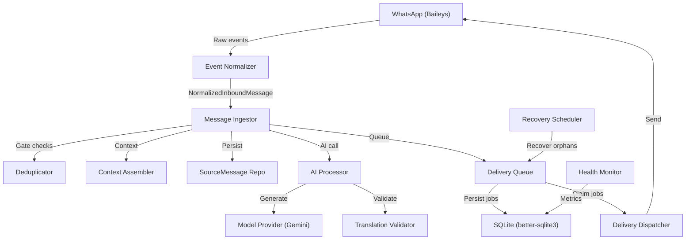

# Architectural Audit — Executive Summary

**Project:** SuaraPutra Smart Multilingual Broadcasting
**Date:** 2026-11-21
**Auditor:** Antigravity Architectural Audit (Automated)
**Scope:** Full codebase structural review — 39 TypeScript source files, 2 SQL migrations, all tests and scripts

---

## Overview

SuaraPutra is a WhatsApp-based automated multilingual broadcasting system that ingests messages from source WhatsApp groups, classifies them as announcements via AI (Gemini), translates them into 4 languages (Malay, English, Mandarin, Tamil), and delivers them to language-specific destination groups.

**Overall Assessment:** The codebase demonstrates **solid foundational architecture** with clear separation of concerns, a well-designed pipeline model, and thoughtful error handling. However, there are several structural weaknesses that could cause reliability issues at scale and make the system harder to maintain.

---

## Findings Summary by Severity

| Severity | Count | Category Breakdown |
|----------|-------|--------------------|
| 🔴 CRITICAL | 3 | Constructor side-effects (1), Migration drift (1), Unbounded memory (1) |
| 🟠 HIGH | 9 | Coupling issues (3), Missing DI (2), Data integrity gaps (2), Error handling (2) |
| 🟡 MEDIUM | 14 | Design pattern improvements, telemetry gaps, hardcoded values |
| 🟢 LOW | 8 | Code style, minor improvements, documentation gaps |

---

## Top 5 Issues Requiring Attention

### 1. 🔴 Constructor Performs I/O & Side Effects (CRITICAL)
`SuaraPutraApplication` constructor runs database migrations, creates repositories, and wires the entire object graph synchronously. This violates the principle that constructors should only assign fields — no I/O, no throwing from external systems.
**→ See:** [01-service-wiring.md](./01-service-wiring.md#1-constructor-side-effects)

### 2. 🔴 Migration List Is Hardcoded & Drifted (CRITICAL)
`migrator.ts` hardcodes migration names as `['001_initial_schema', '002_delivery_attempts']`, but the filesystem has `002_delivery_attempts.sql` — not `002_delivery_tracking.sql`. Adding new migrations requires editing TypeScript code rather than auto-discovering `.sql` files.
**→ See:** [02-database.md](./02-database.md#1-hardcoded-migration-list)

### 3. 🔴 Unbounded In-Memory Tracer Map (CRITICAL)
`SuaraPutraApplication.tracers` is a `Map<string, PipelineTracer>` that grows without bound — entries are added on every announcement but only removed for the last language (order 4) in the dispatcher. If delivery fails or stalls, tracers accumulate indefinitely.
**→ See:** [01-service-wiring.md](./01-service-wiring.md#3-unbounded-tracer-map)

### 4. 🟠 Poor Dependency Injection — All Repositories Instantiated in Constructor (HIGH)
Every repository is `new`-ed directly in `app.ts` constructor. There's no DI container, making it impossible to swap implementations for testing without constructing the entire app.
**→ See:** [01-service-wiring.md](./01-service-wiring.md#2-no-dependency-injection)

### 5. 🟠 `DeliveryQueue` Has God-Object Tendencies (HIGH)
`queue.ts` at 416 lines acts as both a queue, an event logger, an attempt tracker, and an announcement reconciler. It violates single-responsibility and makes testing difficult.
**→ See:** [04-delivery-queue.md](./04-delivery-queue.md#1-god-object)

---

## Audit Documents

| # | Document | Focus Area |
|---|----------|------------|
| 01 | [Service Wiring & Module Coupling](./01-service-wiring.md) | App bootstrap, DI, module coupling, configuration |
| 02 | [Database Architecture](./02-database.md) | Schema design, migrations, repositories, data integrity |
| 03 | [AI Processing Pipeline](./03-ai-pipeline.md) | Prompt engineering, provider abstraction, validation |
| 04 | [Delivery & Queue System](./04-delivery-queue.md) | Queue reliability, retry logic, backpressure |
| 05 | [Ingestion & Data Flow](./05-ingestion-dataflow.md) | Message ingestion, deduplication, media handling |
| 06 | [Observability, Testing & Security](./06-observability-testing-security.md) | Logging, telemetry, test coverage, security |

---

## Architecture Diagram (Current State)

---

## Positive Findings

The audit also identified several **well-executed** aspects worth preserving:

1. **Clean adapter interface** — `IWhatsAppAdapter` properly abstracts WhatsApp, enabling `MockWhatsAppAdapter` for testing
2. **Deterministic IDs** — `deterministicId()` prevents duplicate announcements elegantly
3. **Idempotency keys** — Delivery jobs use composite idempotency keys preventing double-delivery
4. **Lease-based job claiming** — The `claimNext()` with lease expiry is a solid pattern for work distribution
5. **Pipeline tracing** — The checkpoint-based tracing system provides good observability
6. **Zod-based config validation** — Environment configuration is rigorously validated at startup
7. **WAL mode + busy_timeout** — SQLite is configured correctly for concurrent access
8. **Atomic write for media** — `MediaStore.save()` uses temp-file + rename for crash-safe writes
9. **Structured error hierarchy** — `WhatsAppError` subclasses enable proper retry logic classification
10. **Graceful shutdown** — `stop()` drains dispatcher, checkpoints WAL, and disconnects cleanly
