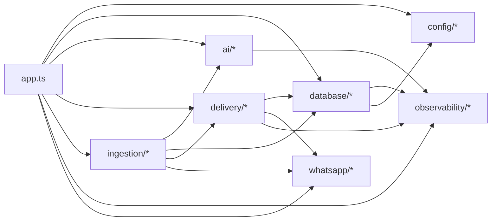

# Audit 01 — Service Wiring & Module Coupling

**Scope:** `src/app.ts`, `src/config/`, `src/shared/`, `src/routing/`, `package.json`, `tsconfig.json`

---

## Findings

### 1. Constructor Side-Effects — 🔴 CRITICAL {#1-constructor-side-effects}

**File:** [`src/app.ts`](../../src/app.ts#L47-L103)
**Category:** Architecture

The `SuaraPutraApplication` constructor performs extensive I/O and side effects:

```
Line 52: new MigrationRunner(this.database).migrate()     // Runs SQL DDL
Line 73: this.ingestor = new MessageIngestor(...)          // Complex object graph
Line 101: this.ingestor.attach(this.adapter)               // Subscribes to events
Line 102: if (...) this.startDispatchLoop()                // Starts interval timer
```

**Why this is a problem:**
- Constructors should be pure — assign fields only. I/O belongs in an `init()` or `start()` method.
- If migration fails, the constructor throws mid-way, leaving a partially-constructed object. The database is open but the WAL isn't checkpointed, timers aren't cleared, and the adapter isn't cleaned up.
- Testing requires calling the constructor, which runs real migrations even in test mode.
- The dispatch loop starts before `start()` is called, meaning the dispatcher could try to send messages before WhatsApp is connected.

**Recommendation:**
- Split constructor into field assignment only.
- Move `migrate()`, `attach()`, and `startDispatchLoop()` into `start()`.
- Add a static factory method: `static async create(options): Promise<SuaraPutraApplication>`.

---

### 2. No Dependency Injection Container — 🟠 HIGH {#2-no-dependency-injection}

**File:** [`src/app.ts`](../../src/app.ts#L47-L97)
**Category:** Architecture / Testability

All 11 repositories and services are instantiated directly in the constructor with `new`:

```typescript
const sources = new SourceMessageRepository(this.database);
const announcements = new AnnouncementRepository(this.database);
const translations = new TranslationRepository(this.database);
const jobs = new DeliveryJobRepository(this.database);
const events = new EventLogRepository(this.database);
```

**Why this is a problem:**
- Cannot swap any single repository in tests without constructing the entire application.
- Adding a new dependency (e.g., a cache, an external API client) requires modifying the constructor.
- No lifecycle management — no way to know which services need cleanup.

**Recommendation:**
- Create a `ServiceContainer` or use a simple registry pattern.
- Accept repositories through `ApplicationOptions` with sensible defaults.
- At minimum, make repositories available as named properties for test override.

---

### 3. Unbounded Tracer Map — 🔴 CRITICAL {#3-unbounded-tracer-map}

**File:** [`src/app.ts`](../../src/app.ts#L44)
**Category:** Performance / Memory Leak

```typescript
private readonly tracers = new Map<string, PipelineTracer>();
```

Tracers are added in `MessageIngestor` (line 84) but only removed in `DeliveryDispatcher.dispatchNext()` (line 98) when `job.languageOrder === 4`. If:
- An announcement has fewer than 4 language jobs (shouldn't happen, but nothing enforces it)
- Delivery fails permanently before reaching language 4
- The announcement is ignored (never queued, never dispatched)

...the tracer stays in memory forever.

**Recommendation:**
- Add a TTL-based eviction or use a `WeakRef`-based cache.
- Clear tracers in `reconcileAnnouncementStatus()` when the announcement reaches a terminal state.
- Add a periodic cleanup in the retention cycle.

---

### 4. Dispatch Loop Starts Before Connection — 🟠 HIGH

**File:** [`src/app.ts`](../../src/app.ts#L102)
**Category:** Race Condition

```typescript
constructor(options: ApplicationOptions = {}) {
    // ... (line 102)
    if (options.startDeliveryLoop !== false) this.startDispatchLoop();
}

async start(): Promise<void> {
    // ... (line 115)
    await this.adapter.connect();
}
```

The dispatch loop starts in the constructor, but `adapter.connect()` is called in `start()`. If there are pending delivery jobs in the database from a previous run, the dispatcher will try to send messages before WhatsApp is connected, causing `WhatsAppTransientError('WhatsApp socket is not open')` on every job.

This triggers unnecessary retry attempts and wastes the retry budget.

**Recommendation:**
- Move `startDispatchLoop()` to the end of `start()`, after `adapter.connect()` resolves.

---

### 5. LANGUAGE_ORDER Duplicated Across Files — 🟡 MEDIUM

**Files:**
- [`src/routing/message-router.ts`](../../src/routing/message-router.ts#L5-L10)
- [`src/ingestion/message-ingestor.ts`](../../src/ingestion/message-ingestor.ts#L19-L21)

**Category:** Code Duplication / Maintainability

The language order mapping `[{ code: 'ms', order: 1 }, { code: 'en', order: 2 }, ...]` is defined identically in both `message-router.ts` and `message-ingestor.ts`. If a language is added or the ordering changes, both must be updated in lockstep.

**Recommendation:**
- Define `LANGUAGE_ORDER` once in `src/config/languages.ts` and import it everywhere.

---

### 6. `logSafeConfig` Receives Full Config Including Secrets — 🟡 MEDIUM

**File:** [`src/app.ts`](../../src/app.ts#L50)
**Category:** Security

```typescript
logSafeConfig(this.logger, this.config);
```

The function signature is `logSafeConfig(logger: Logger, config: Record<string, unknown>)`. While `getSafeConfig()` exists in `env.ts` to strip `AI_API_KEY`, the actual call in `app.ts` passes `this.config` directly — the full config object. The logger's `redact` paths handle `AI_API_KEY`, but this is defense-in-depth only.

**Recommendation:**
- Call `logSafeConfig(this.logger, getSafeConfig(this.config))` instead of passing the full config.

---

### 7. `BROADCAST_KILL_SWITCH` Is a String Enum, Not Boolean — 🟡 MEDIUM

**File:** [`src/config/env.ts`](../../src/config/env.ts#L45)
**Category:** Design / Developer Experience

```typescript
BROADCAST_KILL_SWITCH: z.enum(['true', 'false']).default('false'),
```

This is compared as `this.config.BROADCAST_KILL_SWITCH === 'true'` in `app.ts`. Using a string enum for a boolean value is error-prone and non-idiomatic.

**Recommendation:**
- Use `z.coerce.boolean()` or a transform: `z.string().transform(v => v === 'true')`.

---

### 8. `MAX_CONCURRENT_INGESTIONS` Is Hardcoded to Max 1 — 🟡 MEDIUM

**File:** [`src/config/env.ts`](../../src/config/env.ts#L39)
**Category:** Scalability

```typescript
MAX_CONCURRENT_INGESTIONS: z.coerce.number().int().min(1).max(1).default(1),
```

The `.max(1)` constraint means this config value can never be anything but 1. This is currently correct (the ingestion queue is FIFO and single-threaded), but the config field's existence implies future concurrency support. The constraint should be documented.

**Recommendation:**
- Either remove the config field (it's always 1) or raise the max and implement concurrent ingestion support.

---

### 9. No `process.exit()` After Shutdown — 🟢 LOW

**File:** [`src/app.ts`](../../src/app.ts#L177-L183)
**Category:** Reliability

```typescript
const shutdown = async (signal: string) => {
    console.log(`[APP] ${signal} received; shutting down`);
    await application.stop();
};
process.once('SIGINT', () => { void shutdown('SIGINT'); });
```

After `shutdown()` completes, the process may hang if any unref'd timers or open handles remain. The process should exit explicitly.

**Recommendation:**
- Add `process.exit(0)` after `await application.stop()`.
- Consider a timeout: if shutdown takes too long, force `process.exit(1)`.

---

### 10. `recovery.intervalMs` Calculation Is Confusing — 🟢 LOW

**File:** [`src/app.ts`](../../src/app.ts#L94-L96)
**Category:** Readability

```typescript
this.recovery = new DeliveryRecoveryScheduler(this.queue, {
    intervalMs: this.config.DELIVERY_POLL_INTERVAL_MS * 60
});
```

The recovery interval is `DELIVERY_POLL_INTERVAL_MS * 60` — if the poll interval is 1000ms (default), recovery runs every 60 seconds. This implicit multiplication is non-obvious. A dedicated config field like `DELIVERY_RECOVERY_INTERVAL_MS` would be clearer.

---

## Module Dependency Analysis



**No circular dependencies detected.** The dependency graph is a clean DAG (directed acyclic graph). The `app.ts` module acts as the composition root, which is correct. However, `ingestion/message-ingestor.ts` depends on `delivery/queue.ts`, creating tight coupling between the ingestion and delivery layers — these should communicate through an event/callback pattern instead.
