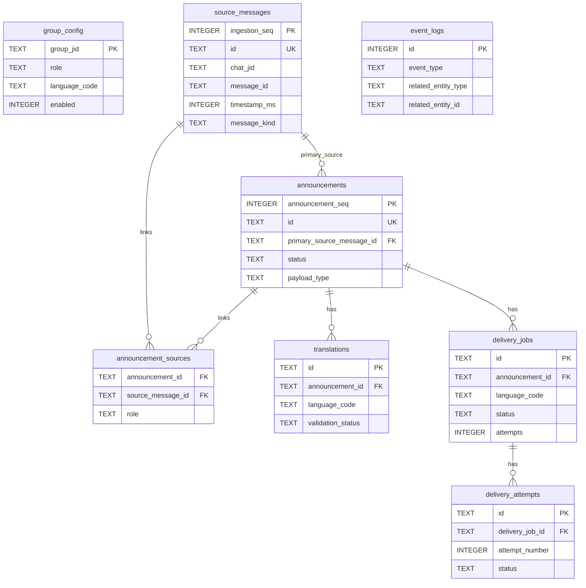

# Audit 02 — Database Architecture

**Scope:** `src/database/`, `src/database/migrations/`, `src/shared/types.ts`

---

## Findings

### 1. Hardcoded Migration List With Stale Reference — 🔴 CRITICAL {#1-hardcoded-migration-list}

**File:** [`src/database/migrator.ts`](../../src/database/migrator.ts#L22)
**Category:** Migration / Reliability

```typescript
const migrations = ['001_initial_schema', '002_delivery_attempts'];
```

**Problems:**
- Migrations are hardcoded as a string array. Adding a new migration requires editing TypeScript code, rebuilding, and redeploying — rather than just dropping a `.sql` file.
- If a developer adds `003_foo.sql` to the migrations folder but forgets to update this array, the migration silently never runs.
- The old code referenced `'002_delivery_tracking'` which was renamed to `'002_delivery_attempts'` — this kind of drift is exactly what auto-discovery prevents.

**Recommendation:**
- Auto-discover migrations by reading `*.sql` files from the migrations directory, sorting alphanumerically.
- Use glob/readdir pattern: `readdirSync(migrationDirectory).filter(f => f.endsWith('.sql')).sort()`.

---

### 2. No Down Migrations or Rollback Support — 🟠 HIGH

**File:** [`src/database/migrator.ts`](../../src/database/migrator.ts#L12-L36)
**Category:** Migration / DevOps

The migration system only runs forward. There are no "down" migrations, no version rollback, and no way to undo a migration that introduced a bug.

**Current risk:** If migration `002` corrupts data or has a schema error, the only recovery is manual SQL intervention or restoring from a database backup.

**Recommendation:**
- Add a `down.sql` companion for each migration.
- Add a `rollback(version: string)` method to `MigrationRunner`.
- At minimum, back up the database before running migrations (copy `.sqlite` file).

---

### 3. `SELECT *` Used Everywhere — 🟡 MEDIUM

**Files:** All repository files
**Category:** Performance / Maintainability

Every repository uses `SELECT *` for reads:

```typescript
// source-message.repo.ts line 74
this.client.prepare('SELECT * FROM source_messages WHERE id = ?')

// delivery-job.repo.ts line 66
this.client.prepare('SELECT * FROM delivery_jobs WHERE id = ?')
```

**Problems:**
- Fetches all columns including potentially large fields like `raw_payload_json` and `raw_ai_response_json` even when only `id` and `status` are needed.
- Schema changes (adding columns) can silently break row-to-type mappings if the TypeScript type isn't updated simultaneously.
- The `pollNext()` query in `delivery-job.repo.ts` does a `SELECT candidate.*` with a correlated `NOT EXISTS` subquery — selecting all columns in the outer query adds unnecessary I/O.

**Recommendation:**
- Enumerate columns explicitly in queries.
- Create separate "lightweight" query methods for cases where only a few fields are needed (e.g., `findStatusById()`).

---

### 4. No Index on `delivery_jobs.target_group_jid` for Poll Query — 🟠 HIGH

**File:** [`src/database/migrations/001_initial_schema.sql`](../../src/database/migrations/001_initial_schema.sql#L97)
**Category:** Performance

The `pollNext()` method in `delivery-job.repo.ts` runs a correlated subquery:

```sql
WHERE earlier.target_group_jid = candidate.target_group_jid
  AND earlier.status IN ('pending', 'sending', 'retry_wait')
```

This checks for earlier undelivered jobs **per target group**. The existing `idx_delivery_jobs_fifo_poll` index covers `(status, next_attempt_at, source_timestamp_ms, announcement_seq, language_order)` but does **not** include `target_group_jid`. The correlated subquery does a full scan of `delivery_jobs` for each candidate.

With a small dataset this is fine, but as the table grows, this becomes O(n²).

**Recommendation:**
- Add a composite index: `CREATE INDEX idx_delivery_jobs_group_status ON delivery_jobs (target_group_jid, status, source_timestamp_ms, announcement_seq, language_order)`.

---

### 5. Insert-Then-Read Pattern Wastes a Query — 🟡 MEDIUM

**Files:** All repository files
**Category:** Performance

Every repository follows this pattern:

```typescript
// announcement.repo.ts line 34-41
this.client.prepare(`INSERT INTO announcements ...`).run({...});
return this.findById(input.id) ?? (() => { throw new Error(...); })();
```

The insert is immediately followed by a `SELECT` to read back the auto-generated fields (`created_at`, `updated_at`, `announcement_seq`). This doubles the query count for every write operation.

**Recommendation:**
- Use SQLite's `RETURNING` clause (supported in SQLite 3.35+, and `better-sqlite3` supports it): `INSERT ... RETURNING *`.
- This eliminates the read-after-write round trip.

---

### 6. `event_logs` Table Has No Retention Policy — 🟠 HIGH

**File:** [`src/database/migrations/001_initial_schema.sql`](../../src/database/migrations/001_initial_schema.sql#L100-L110)
**Category:** Data Integrity / Performance

The `event_logs` table is append-only with no pruning. `HealthMonitor.runRetention()` only prunes `source_messages` and media files — it does not touch `event_logs`.

Every delivery attempt, state change, retry decision, and recovery event appends a row. At steady state, this table will grow without bound and eventually:
- Slow down the database (bloated WAL, slow checkpoints)
- Consume disk space unnecessarily
- Make the index on `(related_entity_type, related_entity_id, created_at)` increasingly expensive

**Recommendation:**
- Add event_logs pruning to `runRetention()`: delete events older than `DATA_RETENTION_DAYS`.
- Consider archiving CRITICAL/ERROR events before deletion.

---

### 7. No Foreign Key on `delivery_jobs.target_group_jid` to `group_config` — 🟡 MEDIUM

**File:** [`src/database/migrations/001_initial_schema.sql`](../../src/database/migrations/001_initial_schema.sql#L70-L96)
**Category:** Data Integrity

The `group_config` table exists and has destination groups configured, but `delivery_jobs.target_group_jid` is a plain `TEXT` with no foreign key reference. If a group JID is misconfigured or the config changes, old delivery jobs may reference non-existent groups.

**Note:** This is partly by design (groups are configured via environment variables, not the `group_config` table), but it means `group_config` is effectively unused — dead schema.

**Recommendation:**
- Either use `group_config` as the source of truth (with FK from `delivery_jobs`) or remove the `group_config` table to avoid confusion.

---

### 8. `DatabaseClient.prepare()` Uses Proxy for Instrumentation — 🟡 MEDIUM

**File:** [`src/database/client.ts`](../../src/database/client.ts#L24-L37)
**Category:** Performance / Complexity

```typescript
prepare(sql: string): Database.Statement {
    const statement = this.database.prepare(sql);
    return new Proxy(statement, { ... });
}
```

Every `prepare()` call wraps the statement in a `Proxy`. Proxies have inherent overhead (they go through the JavaScript engine's handler trap mechanism on every property access), and `prepare()` is called on every single database operation.

**Recommendation:**
- If instrumentation is only needed in development/debug, conditionally skip the Proxy in production.
- Alternatively, create explicit wrapper methods (`run()`, `get()`, `all()`) on a thin wrapper class instead of using Proxy.

---

### 9. Announcement `evaluation_score` Is `REAL` Without Precision Control — 🟢 LOW

**File:** [`src/database/migrations/001_initial_schema.sql`](../../src/database/migrations/001_initial_schema.sql#L41)
**Category:** Schema Design

```sql
evaluation_score REAL NOT NULL,
```

Floating-point scores (1.0–10.0) stored as `REAL` can have precision issues. For example, `4.0` stored as IEEE 754 might compare differently than expected. The validator compares `response.score >= this.scoreThreshold`, which could fail on edge cases.

**Recommendation:**
- Store scores as integers (multiply by 10, store as INTEGER) or use a CHECK constraint to validate range.

---

### 10. `translations` Table Has No Retention Pruning — 🟡 MEDIUM

**File:** [`src/database/repositories/translation.repo.ts`](../../src/database/repositories/translation.repo.ts)
**Category:** Data Growth

Unlike `source_messages` (which has `pruneBefore()`), the `translations` table has no pruning mechanism. Translations are linked to announcements via foreign key with `ON DELETE CASCADE`, so they would be cleaned if announcements were deleted — but announcements also have no pruning.

**Recommendation:**
- Add announcement pruning to the retention policy (delete completed/failed announcements older than `DATA_RETENTION_DAYS`), which will cascade-delete translations and delivery jobs.

---

## Schema Relationship Diagram


