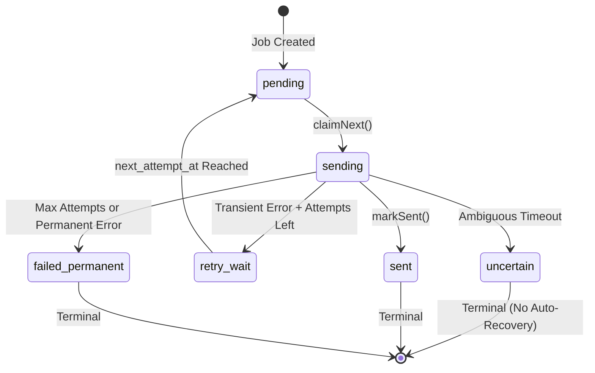

# Audit 04 — Delivery & Queue System

**Scope:** `src/delivery/`, `src/whatsapp/`, queue-related parts of `src/database/repositories/`

---

## Findings

### 1. `DeliveryQueue` Is a God Object — 🟠 HIGH {#1-god-object}

**File:** [`src/delivery/queue.ts`](../../src/delivery/queue.ts) (416 lines)
**Category:** Design Pattern / Maintainability

`DeliveryQueue` violates the Single Responsibility Principle. It is simultaneously:

1. **A queue** — `claimNext()`, `persistAnnouncement()`
2. **An event logger** — `this.events.append()` after every operation
3. **An attempt tracker** — `startAttempt()`, `markAttemptSent()`, `markAttemptFailed()`
4. **A reconciler** — `reconcileAnnouncementStatus()` checks if all 4 languages are delivered
5. **A recovery manager** — `recoverOrphanedJobs()`
6. **A validator** — `validateTranslations()`

This makes the class:
- Hard to test (every test needs event log mocking)
- Hard to reason about (methods have unexpected side effects like reconciliation)
- A bottleneck for changes (any queue change requires understanding all responsibilities)

**Recommendation:**
- Extract `AnnouncementReconciler` — responsible for `reconcileAnnouncementStatus()`
- Extract `DeliveryEventLogger` — wraps `EventLogRepository` with delivery-specific event types
- Extract `DeliveryAttemptTracker` — manages attempt lifecycle
- Keep `DeliveryQueue` focused on job CRUD and claim/release

---

### 2. `reconcileAnnouncementStatus` Hardcodes 4 Languages — 🟠 HIGH

**File:** [`src/delivery/queue.ts`](../../src/delivery/queue.ts#L199)
**Category:** Design / Extensibility

```typescript
if (jobs.length !== 4 || jobs.some(candidate =>
    !['sent', 'failed_permanent', 'uncertain', 'cancelled'].includes(candidate.status)
)) return;
```

The reconciliation assumes exactly 4 delivery jobs per announcement (one per language). If a fifth language is added, or if a language is temporarily disabled, this check silently prevents announcement status updates.

**Recommendation:**
- Derive expected job count from configuration or from the actual jobs created.
- Replace `jobs.length !== 4` with `jobs.some(j => ['pending', 'sending', 'retry_wait'].includes(j.status))`.

---

### 3. `pollNext()` Query Is Complex and Potentially Slow — 🟡 MEDIUM

**File:** [`src/database/repositories/delivery-job.repo.ts`](../../src/database/repositories/delivery-job.repo.ts#L77-L103)
**Category:** Performance

The `pollNext()` query enforces ordering guarantees (earlier announcements before later ones, within an announcement: Malay → English → Mandarin → Tamil) using a correlated `NOT EXISTS` subquery. While correct, this:

- Scans the entire `delivery_jobs` table for each candidate row
- Gets slower as the table grows with historical completed/failed jobs
- Has no index covering the `target_group_jid` + `status` combination in the subquery

**Recommendation:**
- Add the index recommended in [02-database.md](./02-database.md#4-no-index-on-target-group-jid).
- Consider a materialized "next job" view or a simpler queue design where completed jobs are archived.

---

### 4. No Dead Letter Queue — 🟠 HIGH

**Files:** [`src/delivery/retry-policy.ts`](../../src/delivery/retry-policy.ts), [`src/delivery/queue.ts`](../../src/delivery/queue.ts)
**Category:** Reliability

When a delivery job reaches `failed_permanent` status, it stays in the `delivery_jobs` table forever. There is:
- No dead letter queue or separate failure table
- No alerting mechanism for permanently failed deliveries
- No manual retry workflow for operators
- No dashboard or query to find and re-queue failed jobs

**Recommendation:**
- Add a `dead_letter_queue` table or status to track permanently failed jobs separately.
- Add an admin API or CLI command to manually re-queue failed jobs.
- Emit a CRITICAL event_log entry (this exists but isn't surfaced to operators).

---

### 5. `uncertain` State Has No Resolution Path — 🟠 HIGH

**File:** [`src/delivery/queue.ts`](../../src/delivery/queue.ts#L283-L308)
**Category:** Reliability

When a delivery times out ambiguously (`WhatsAppAmbiguousTimeoutError`), the job moves to `uncertain` status. This state means: "the message may or may not have been delivered."

**Problems:**
- `uncertain` jobs are never automatically retried (they're terminal states).
- `recoverOrphanedJobs()` only recovers `sending` jobs with expired leases — not `uncertain` ones.
- There's no mechanism for an operator to verify delivery and manually resolve `uncertain` jobs.
- The `reconcileAnnouncementStatus()` treats `uncertain` as terminal, so the announcement may show `partial_failure` even if the message was actually delivered.

**Recommendation:**
- Add a `resolveUncertain(jobId, actualStatus)` method for manual resolution.
- Consider auto-resolving `uncertain` jobs as `sent` if WhatsApp shows the message was delivered (via read receipts or message status updates).
- At minimum, add an admin-visible list of uncertain jobs for manual review.

---

### 6. Media Cache in Dispatcher Has No Size Limit — 🟡 MEDIUM

**File:** [`src/delivery/dispatcher.ts`](../../src/delivery/dispatcher.ts#L27)
**Category:** Memory Management

```typescript
private readonly mediaCache = new Map<string, MediaCacheEntry>();
```

The `mediaCache` caches media file buffers keyed by `announcementId`. Entries are only evicted when `languageOrder === 4` (last language delivered). If multiple announcements with images are being delivered concurrently, all their media buffers are held in RAM simultaneously.

A 10MB image × 10 concurrent announcements = 100MB of RAM just for media cache.

**Recommendation:**
- Add a max cache size (e.g., 5 entries).
- Use an LRU eviction strategy.
- Consider streaming media from disk per-delivery instead of caching.

---

### 7. `Dispatcher.reconstruct()` Throws on Empty Caption — 🟡 MEDIUM

**File:** [`src/delivery/dispatcher.ts`](../../src/delivery/dispatcher.ts#L198-L200)
**Category:** Error Handling

```typescript
if (job.textContent != null && (job.textContent.trim().length === 0 || job.textContent.length > 4096)) {
    throw new DeliveryValidationError(`Delivery job ${job.id} has invalid caption content`);
}
```

If `textContent` is an empty string (not null), the validation throws `DeliveryValidationError`, which the retry policy classifies as `INVALID_DELIVERY_PAYLOAD` → `failed_permanent`. This means the job is permanently abandoned for a potentially recoverable data issue.

**Recommendation:**
- Treat empty caption as null (send image without caption) rather than failing permanently.
- Or add a validation step during job creation to prevent this case.

---

### 8. WhatsApp Reconnection Has No Max Attempt Limit — 🟡 MEDIUM

**File:** [`src/whatsapp/baileys-client.ts`](../../src/whatsapp/baileys-client.ts#L197-L206)
**Category:** Reliability

```typescript
private async scheduleReconnect(): Promise<void> {
    const delayMs = Math.min(60_000, 1000 * (2 ** this.reconnectAttempt) + ...);
    this.reconnectAttempt = Math.min(this.reconnectAttempt + 1, 6);
}
```

The reconnect attempt counter caps at 6 (max delay 60s), but there's no maximum number of reconnect attempts. If WhatsApp is permanently unreachable, the adapter will retry every 60 seconds forever, burning resources and generating log noise.

**Recommendation:**
- Add a maximum reconnect count (e.g., 100 attempts = ~100 minutes).
- After max attempts, transition to `close` state and log a FATAL error.
- Optionally, alert the operator.

---

### 9. `RetryPolicy` Uses `job.attempts` Off-by-One — 🟢 LOW

**File:** [`src/delivery/retry-policy.ts`](../../src/delivery/retry-policy.ts#L37)
**Category:** Logic Correctness

```typescript
const baseSeconds = Math.min(300, 5 * (2 ** Math.max(0, job.attempts - 1)));
```

When `RetryPolicy.decide()` is called, `job.attempts` has already been incremented by `claimNext()`. So on the first actual attempt, `job.attempts === 1`, and the backoff is `5 * 2^0 = 5 seconds`. On the second attempt, it's `5 * 2^1 = 10 seconds`. This is correct but non-obvious — the `-1` adjustment is easy to break.

**Recommendation:**
- Document this invariant with a comment.
- Consider passing `attemptNumber` explicitly instead of relying on the job's pre-incremented state.

---

### 10. `stopAndDrain` May Leave Timer Dangling — 🟢 LOW

**File:** [`src/delivery/dispatcher.ts`](../../src/delivery/dispatcher.ts#L50-L67)
**Category:** Resource Cleanup

`stopAndDrain()` sets `this.stopping = true` and waits for the active dispatch promise, but it doesn't clear `this.stopping` back to `false` if the dispatcher is restarted. The flag is one-way — once stopped, the dispatcher can never be restarted without creating a new instance.

**Recommendation:**
- Document that `stopAndDrain()` is a one-way operation.
- Or reset `this.stopping` in a `restart()` method.

---

## Delivery State Machine


