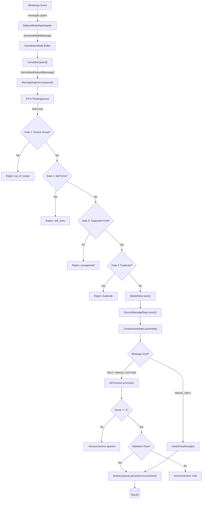

# Audit 05 — Ingestion & Data Flow

**Scope:** `src/ingestion/`, `src/whatsapp/event-normalizer.ts`, `src/whatsapp/adapter.ts`, data flow through `src/app.ts`

---

## Findings

### 1. `message-ingestor.ts` Is a 483-Line Monolith — 🟠 HIGH

**File:** [`src/ingestion/message-ingestor.ts`](../../src/ingestion/message-ingestor.ts) (483 lines)
**Category:** Architecture / Maintainability

`MessageIngestor` is the single largest class in the codebase and handles:
- Message enqueuing and FIFO drain loop
- Gate checks (scope, self-echo, support, dedup)
- Media persistence
- Source message persistence
- Context assembly orchestration
- AI processor invocation
- Delivery queue persistence
- Announcement creation for text, image-caption, and image-only flows
- Recovery of interrupted announcements
- Failed translation persistence

This violates the Single Responsibility Principle. A change to any part of the pipeline risks breaking unrelated stages.

**Recommendation:**
- Extract an `IngestionGatekeeper` class for the 5 gate checks.
- Extract `AnnouncementPipeline` for the AI → validate → persist flow.
- Extract `ImagePassthroughPipeline` for the image-only shortcut.
- Keep `MessageIngestor` as a thin orchestrator calling these components.

---

### 2. Ingestion-to-Delivery Tight Coupling — 🟠 HIGH

**File:** [`src/ingestion/message-ingestor.ts`](../../src/ingestion/message-ingestor.ts#L332-L361)
**Category:** Architecture / Coupling

The ingestion module directly calls `this.options.deliveryQueue.persistAnnouncement(...)`, creating a hard dependency from the ingestion layer to the delivery layer. This means:
- Ingestion cannot be tested without a `DeliveryQueue` instance (or mocking it).
- The ingestion module must know the delivery layer's data structures.
- If the delivery pipeline changes, ingestion code must change too.

**Recommendation:**
- Introduce an event-based decoupling: ingestion emits an `AnnouncementReady` event (or calls a callback), and a separate handler persists it to the delivery queue.
- The `app.ts` composition root would wire: `ingestor.onAnnouncementReady(announcement => queue.persistAnnouncement(announcement))`.

---

### 3. FIFO Queue Uses Array Sort on Every Drain — 🟡 MEDIUM

**File:** [`src/ingestion/message-ingestor.ts`](../../src/ingestion/message-ingestor.ts#L199-L201)
**Category:** Performance

```typescript
while (this.pendingQueue.length > 0) {
    this.pendingQueue.sort((a, b) =>
        a.message.timestampMs - b.message.timestampMs || a.arrivalSeq - b.arrivalSeq
    );
    const item = this.pendingQueue.shift();
```

On every iteration of the drain loop, the entire pending queue is re-sorted. This is O(n log n) per message processed, making the overall drain loop O(n² log n) for n queued messages. Under burst traffic (e.g., many messages arriving while one is being processed), this becomes expensive.

**Recommendation:**
- Use an insertion-sort approach: insert new items in sorted position (binary search + splice) so the queue is always sorted.
- Or use a priority queue / min-heap data structure.

---

### 4. `message.media.buffer` Is Mutated In-Place — 🟡 MEDIUM

**File:** [`src/ingestion/message-ingestor.ts`](../../src/ingestion/message-ingestor.ts#L258)
**Category:** Design Pattern / Side Effects

```typescript
media = await this.options.mediaStore.save(message.messageId, message.media.mimeType, message.media.buffer);
message.media.buffer = null; // ← Mutating the input parameter
```

The ingestor directly mutates the incoming `NormalizedInboundMessage` object by setting `media.buffer = null` after persisting to disk. This is done to release the RAM buffer, but mutating function arguments is a side-effect that:
- Makes debugging harder (the caller's object silently changes)
- Can cause confusion if the message is referenced elsewhere
- Breaks the implicit contract that function parameters are read-only

**Recommendation:**
- Create a new message object with `media.buffer` removed: `const processed = { ...message, media: { ...message.media, buffer: null } }`.
- Or return the buffer-released state as part of the ingestion result.

---

### 5. `recoverInterrupted` Silently Swallows IMAGE_ONLY Failures — 🟡 MEDIUM

**File:** [`src/ingestion/message-ingestor.ts`](../../src/ingestion/message-ingestor.ts#L78-L85)
**Category:** Data Integrity

```typescript
if (!source || source.messageKind === 'IMAGE_ONLY') {
    this.options.announcements.updateOutcome(announcement.id, {
        classification: 'announcement',
        evaluationScore: announcement.evaluationScore,
        status: 'held_validation_failed'
    });
    continue;
}
```

During recovery of interrupted announcements, `IMAGE_ONLY` messages are silently marked as `held_validation_failed` instead of being re-queued for delivery. Image-only messages don't need AI processing — they should be re-queued directly as passthrough deliveries.

**Recommendation:**
- For `IMAGE_ONLY` messages, re-create the passthrough delivery jobs (like `createPassthrough()` does for new messages) instead of marking them as held.

---

### 6. Deduplication Only Checks Message ID, Not Content Hash — 🟡 MEDIUM

**File:** [`src/ingestion/deduplicator.ts`](../../src/ingestion/deduplicator.ts#L8-L10)
**Category:** Data Integrity

```typescript
isDuplicate(message: NormalizedInboundMessage): boolean {
    return this.sources.exists(message.chatJid, message.messageId);
}
```

Deduplication relies solely on `(chatJid, messageId)` existence in the database. The `contentHash()` method exists but is only used for storing the hash — not for dedup checks.

**Problems:**
- WhatsApp message IDs are unique per message, so this technically works for exact duplicates.
- However, if WhatsApp resends the same content with a different message ID (e.g., after a reconnection), it won't be caught.
- The `contentHash` column and index exist in the schema but aren't leveraged for deduplication.

**Recommendation:**
- Add a content-hash-based dedup window: reject messages with the same `contentHash` within a configurable time window (e.g., 60 seconds).
- This would catch near-duplicate resends common in WhatsApp group forwarding.

---

### 7. `MediaStore.save()` Uses Synchronous Write Verification — 🟢 LOW

**File:** [`src/ingestion/media-store.ts`](../../src/ingestion/media-store.ts#L40-L43)
**Category:** Performance

```typescript
const written = await stat(temporaryPath);
if (written.size !== buffer.byteLength || written.size === 0) {
    throw new Error(`Media write verification failed for ${messageId}`);
}
```

After writing the file via a stream, the code does a `stat()` call to verify the written size. While this is a good defensive check, it adds an extra filesystem syscall. The write stream's `finish` event already guarantees all data was flushed.

**Note:** This is a minor concern — the defensive check is valuable and the overhead is minimal.

---

### 8. Event Normalizer Throws on Invalid Media Size — 🟡 MEDIUM

**File:** [`src/whatsapp/event-normalizer.ts`](../../src/whatsapp/event-normalizer.ts#L94-L99)
**Category:** Error Handling / Resilience

```typescript
if (declaredLength !== null && (!Number.isFinite(declaredLength) || declaredLength > options.maxMediaBytes)) {
    throw new WhatsAppInvalidInputError(`Image exceeds configured media limit for message ${messageId}`);
}
```

If a single oversized image message arrives, the normalizer throws an error that propagates up to `BaileysWhatsAppAdapter.handleUpsert()`, which catches it. However, all messages in the same upsert batch are processed sequentially in a `for` loop, and the error aborts processing of the **current message only** — subsequent messages in the batch are still processed.

This is actually correct behavior! But the error class `WhatsAppInvalidInputError` extends `WhatsAppError` which has `failureKind: 'invalid'`, which could be confusing in logs since this isn't really a WhatsApp-level error.

**Recommendation:**
- Use a domain-specific `MediaSizeExceededError` instead.
- Log the skipped message with `WARN` level, not `ERROR`.

---

### 9. No Backpressure on Ingestion Queue — 🟡 MEDIUM

**File:** [`src/ingestion/message-ingestor.ts`](../../src/ingestion/message-ingestor.ts#L171-L191)
**Category:** Reliability / Memory

```typescript
enqueue(message: NormalizedInboundMessage): Promise<IngestionResult> {
    // ...
    this.pendingQueue.push({ message, ... });
    void this.drainQueue();
    return task;
}
```

The ingestion queue has no size limit. If messages arrive faster than they can be processed (e.g., during an AI rate limit), the `pendingQueue` array grows unboundedly. Each queued message holds the full `NormalizedInboundMessage` including any media `Buffer`.

For image messages, this could mean hundreds of MB of media buffers waiting in RAM.

**Recommendation:**
- Add a max queue size (e.g., 100 messages).
- When the queue is full, either drop the message with a warning, or apply backpressure to the WhatsApp handler (delay acknowledging the message).
- At minimum, track queue depth as a telemetry metric.

---

### 10. Context Window Excludes the Current Message's Quoted Chain — 🟢 LOW

**File:** [`src/ingestion/context-assembler.ts`](../../src/ingestion/context-assembler.ts#L30-L44)
**Category:** AI Quality

The context assembler resolves the quoted message and fetches recent messages within the time window, but it doesn't follow the quoted chain recursively. If message A quotes message B which quotes message C, only message B's text is included as context — message C is lost.

**Note:** This is a minor limitation. Recursive quote resolution would add complexity and may not significantly improve translation quality.

---

## End-to-End Data Flow Diagram


