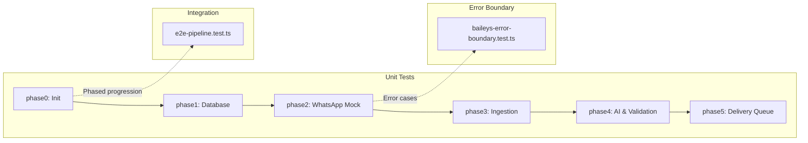

# Audit 06 — Observability, Testing & Security

**Scope:** `src/observability/`, `src/shared/`, `tests/`, `.env.example`, security cross-cuts

---

## Findings

### 1. Telemetry Uses `console.log`/`console.error` Instead of Logger — 🟠 HIGH

**Files:** [`src/observability/telemetry.ts`](../../src/observability/telemetry.ts#L66), [`src/observability/telemetry.ts`](../../src/observability/telemetry.ts#L82), and many other files
**Category:** Observability / Consistency

The project has a well-configured structured logger (Pino) with log levels, PII redaction, and environment-aware formatting. However, the `PipelineTracer` and many other modules bypass it entirely and use raw `console.log` / `console.error` / `console.warn`:

```typescript
// telemetry.ts line 66
console.log(`[TRACE:${this.traceId}] ✔ [${name}] DONE (${durationUs} μs)`, metadata ?? '');

// telemetry.ts line 82
console.error(`[TRACE:${this.traceId}] ✖ [${name}] FAILED after ${durationUs} μs`, metadata);

// ai-processor.ts line 96
console.warn('[WARN] [CP06_VALIDATION:RETRY]', { id: input.id, errors: validation.errors });

// dispatcher.ts line 115
if (tracer) console.error(`[TRACE:${tracer.traceId}] dispatch failed`, { jobId: job.id });

// queue.ts line 225
console.error('[DELIVERY_POST_SEND_PERSISTENCE_FAILED]', { ... });
```

**Problems:**
- `console.*` outputs are not structured JSON — they won't be parseable by log aggregators (ELK, Loki, Datadog).
- Log levels are inconsistent (manual `[WARN]` prefixes vs. logger levels).
- The PII redaction configured in Pino doesn't apply to `console.*` output.
- No correlation between Pino logs and console trace logs.

**Recommendation:**
- Inject the Pino logger into `PipelineTracer` and all services that currently use `console.*`.
- Use `logger.debug()` for trace checkpoints, `logger.warn()` for retries, `logger.error()` for failures.
- Include `traceId` as a structured field for log correlation.

---

### 2. Health Check Doesn't Verify AI Provider — 🟡 MEDIUM

**File:** [`src/observability/health.ts`](../../src/observability/health.ts#L25-L55)
**Category:** Observability / Reliability

```typescript
snapshot(): HealthSnapshot {
    // Checks: WhatsApp connection, delivery job counts
    // Does NOT check: AI provider availability, database connectivity, disk space
}
```

The health snapshot checks WhatsApp connection status and delivery queue metrics, but misses:
- **AI provider health** — Is the Gemini API reachable? Is the API key valid? Is the quota exhausted?
- **Database connectivity** — A simple `SELECT 1` to verify SQLite is accessible.
- **Disk space** — Media storage and database can fill the disk.

**Recommendation:**
- Add an AI health probe: attempt a minimal Gemini API call or check API key validity.
- Add a database liveness check: `this.client.prepare('SELECT 1').get()`.
- Add disk space monitoring for `MEDIA_STORAGE_DIR` and `DATABASE_URL` paths.

---

### 3. No Structured Metrics Export — 🟡 MEDIUM

**File:** [`src/observability/telemetry.ts`](../../src/observability/telemetry.ts)
**Category:** Observability

The `PipelineTracer` captures excellent checkpoint-level timing data, but the `JourneySummary` is only logged to stdout. There's no metrics export to Prometheus, StatsD, or any time-series database.

Key metrics that should be tracked over time:
- Messages ingested per minute (by kind, by outcome)
- AI processing latency (p50, p95, p99)
- Translation validation pass/fail rate
- Delivery success/failure rate by language and group
- Queue depth over time
- End-to-end pipeline latency

**Recommendation:**
- Add a `MetricsCollector` that aggregates `JourneySummary` data.
- Export via Prometheus `/metrics` endpoint (since `WEB_ADMIN_ENABLED` already exists in config).
- At minimum, periodically log aggregated metrics at INFO level.

---

### 4. PII Not Scrubbed From Event Logs — 🟠 HIGH

**File:** [`src/database/repositories/event-log.repo.ts`](../../src/database/repositories/event-log.repo.ts#L15-L25)
**Category:** Security / Privacy

```typescript
append(input: EventLogInput): number {
    // ...
    input.level, JSON.stringify(input.details)
```

Event log details are stored as raw JSON. Several callers include potentially sensitive data:

```typescript
// queue.ts line 100-105 - stores workerId, targetGroupJid
details: { workerId, targetGroupJid: job.targetGroupJid, ... }

// Various places store errorMessage which may contain user content
details: { errorCode, errorMessage }
```

While WhatsApp JIDs aren't typically classified as PII, the `errorMessage` fields could contain user message content if an error occurs during processing.

**Recommendation:**
- Sanitize `errorMessage` before storing: truncate and strip any embedded user content.
- Add a `sanitizeDetails()` function that removes or masks sensitive fields.
- Document what data the `event_logs` table may contain for GDPR/privacy compliance.

---

### 5. Test Coverage Gaps — Critical Paths Not Tested — 🟠 HIGH

**Directory:** [`tests/`](../../tests/)
**Category:** Testing

Reviewing the test files reveals several **untested critical paths**:

| Critical Path | Test Status |
|---|---|
| `recoverInterrupted()` — full recovery flow | ❌ Not unit-tested |
| `reconcileAnnouncementStatus()` — terminal state detection | ❌ Not unit-tested |
| `recoverOrphanedJobs()` — lease expiry recovery | ❌ Not unit-tested |
| `BaileysWhatsAppAdapter.scheduleReconnect()` | ❌ Not unit-tested |
| `HealthMonitor.runRetention()` — media + DB pruning | ❌ Not unit-tested |
| Concurrent ingestion (multiple messages in queue) | ❌ Not tested |
| `DeliveryDispatcher` with real `RetryPolicy` | ⚠️ Partially (mock policy) |
| Event normalizer with viewOnce / ephemeral messages | ⚠️ Partially |

**Recommendation:**
- Prioritize tests for `recoverInterrupted()` and `reconcileAnnouncementStatus()` — these are complex state machine transitions.
- Add a stress test for the ingestion queue under burst traffic.
- Add integration tests for the full recovery scheduler → dispatcher cycle.

---

### 6. `.env.example` Exposes Real Group JIDs Pattern — 🟢 LOW

**File:** [`.env.example`](../../.env.example)
**Category:** Security

The `.env.example` file should contain only placeholder values. If it contains real or realistic JIDs, it leaks information about the production setup. (The actual file should be verified — the schema shows JID format `[0-9-]+@g.us`.)

**Recommendation:**
- Ensure `.env.example` uses clearly fake values like `1234567890-0000000000@g.us`.
- Add a comment in `.env.example` explaining each field.

---

### 7. No Rate Limiting on AI API Calls — 🟡 MEDIUM

**File:** [`src/ai/ai-processor.ts`](../../src/ai/ai-processor.ts#L160-L193)
**Category:** Security / Cost

The AI processor retries up to 3 times with short delays (1-2 seconds), but there's no global rate limiter. If 10 messages arrive simultaneously, all 10 will fire AI requests in parallel (the ingestion queue is FIFO but `MAX_CONCURRENT_INGESTIONS` is 1, so they'd be sequential — mitigating this for now).

However, the recovery flow `recoverInterrupted()` processes all interrupted announcements sequentially with no rate limiting, which could burst many AI calls.

**Recommendation:**
- Add a token-bucket or sliding-window rate limiter for AI API calls.
- Track daily/hourly API usage and pause processing when limits are approached.

---

### 8. Error Hierarchy Is Incomplete — 🟡 MEDIUM

**File:** [`src/shared/errors.ts`](../../src/shared/errors.ts)
**Category:** Design Pattern

The custom error hierarchy has only 4 classes:
- `PersistenceError` → `DuplicateRecordError`, `MigrationError`
- `DeliveryValidationError`

Missing error types that are currently thrown as generic `Error`:
- AI processing failures (thrown as `new Error('Invalid AI response: ...')`)
- Configuration errors (thrown as `new Error('Invalid environment configuration: ...')`)
- Media handling errors (thrown as `new Error('Media for ... is empty')`)
- Context assembly errors (thrown as `new Error('At least one source group JID...')`)

**Recommendation:**
- Add `AiProcessingError extends Error` for all AI-related failures.
- Add `ConfigurationError extends Error` for startup config issues.
- Add `MediaError extends Error` for media handling failures.
- This enables more precise error handling in catch blocks.

---

### 9. `crypto.ts` Uses Truncated SHA-256 for Deterministic IDs — 🟢 LOW

**File:** [`src/shared/crypto.ts`](../../src/shared/crypto.ts#L11-L13)
**Category:** Security / Data Integrity

```typescript
export function deterministicId(...parts: string[]): string {
    return sha256Hex(parts.join('\u001f')).slice(0, 32);
}
```

The deterministic ID is a 32-character hex string (128 bits of a 256-bit hash). While 128 bits provides an astronomically low collision probability for the expected data volumes, the truncation is unusual and should be documented.

**Note:** At the current scale (thousands of announcements), collision probability is negligible (birthday paradox threshold is ~2^64 ≈ 1.8×10¹⁹ for 128-bit).

**Recommendation:**
- Add a code comment explaining why 32 hex chars (128 bits) is sufficient.
- Consider using the full 64-char hash to eliminate any theoretical concern.

---

### 10. Graceful Shutdown Doesn't Wait for Pending Ingestion — 🟡 MEDIUM

**File:** [`src/app.ts`](../../src/app.ts#L118-L131)
**Category:** Reliability

```typescript
async stop(): Promise<void> {
    // ...
    const drained = await this.dispatcher.stopAndDrain(this.config.DELIVERY_SEND_TIMEOUT_MS);
    this.recovery.stop();
    await this.adapter.disconnect();
    this.database.close();
}
```

The shutdown sequence drains the dispatcher and stops recovery, but it doesn't wait for the ingestion queue to finish processing. If a message is mid-processing (AI call in progress), the shutdown will:
1. Disconnect WhatsApp (line 128) — interrupting any pending media downloads.
2. Close the database (line 130) — causing SQLite errors if the ingestion pipeline tries to write.

The announcement will be left in `processing` status and require `recoverInterrupted()` on next startup.

**Recommendation:**
- Add `await this.ingestor.drainAndStop()` before disconnecting the adapter.
- Or add a "shutting down" flag that prevents new ingestions and waits for the current one to complete.

---

## Test Architecture Assessment



**Strengths:**
- Phased test progression mirrors the pipeline stages — good for onboarding.
- Uses Vitest with proper mocking for external dependencies.
- E2E integration test covers the happy path end-to-end.

**Weaknesses:**
- No negative/edge-case integration tests (what happens when AI fails mid-pipeline in e2e?).
- No load/stress tests.
- No test for the full shutdown → recovery → restart cycle.

---

## Security Summary

| Area | Status | Notes |
|------|--------|-------|
| API Key Storage | ✅ Good | Env var, excluded from logs via redact |
| SQL Injection | ✅ Good | All queries use parameterized statements |
| Path Traversal | ✅ Good | `MediaStore.load()` validates relative path |
| Prompt Injection | ⚠️ Medium | User content passes to AI without sandboxing |
| PII in Logs | ⚠️ Medium | Pino redacts, but `console.*` calls bypass it |
| PII in Event Logs DB | ⚠️ Medium | Error messages may contain user content |
| Auth State Files | ✅ Good | Stored in `private/whatsapp-auth`, gitignored |
| Dependency Security | ⚠️ Low | No `npm audit` in CI, Baileys is RC version |
| Data at Rest | ❌ Not encrypted | SQLite DB is unencrypted on disk |
