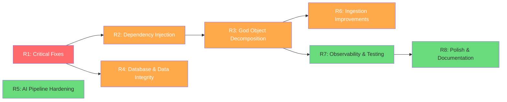

# SuaraPutra: Architectural Remediation Execution Plan

**Project:** SuaraPutra — Smart Multilingual Broadcasting
**Document Path:** `docs/audits/remediation-plan.md`
**Version:** 1.0.0
**Created:** 24 November 2026
**Based On:** [Architectural Audit — Executive Summary](./00-executive-summary.md)
**Executing Agent:** `gpt-6-luna`

---

## 1. Purpose & Scope

This plan provides an ordered, phase-gated remediation of all **34 findings** (3 CRITICAL, 9 HIGH, 14 MEDIUM, 8 LOW) identified in the [Architectural Audit](./00-executive-summary.md) conducted on 21 November 2026. Each phase is self-contained, testable, and designed for execution by `gpt-6-luna`.

### 1.1 Guiding Principles

1. **CRITICAL findings first** — fix memory leaks, race conditions, and drift risks before feature-level improvements.
2. **Dependency-aware ordering** — DI refactoring (R2) must precede god-object decomposition (R3), database fixes (R4) before ingestion improvements (R6).
3. **No feature additions** — this plan strictly remediates existing structural issues. No new user-facing features.
4. **Test-first verification** — every phase includes specific verification criteria and test commands.
5. **Incremental commits** — each phase produces a scoped, reviewable commit.

### 1.2 Audit Documents Reference

| # | Document | Findings |
|---|----------|----------|
| 00 | [Executive Summary](./00-executive-summary.md) | Overview, top 5 issues, positive findings |
| 01 | [Service Wiring & Module Coupling](./01-service-wiring.md) | 10 findings (2 CRITICAL, 2 HIGH, 4 MEDIUM, 2 LOW) |
| 02 | [Database Architecture](./02-database.md) | 10 findings (1 CRITICAL, 2 HIGH, 5 MEDIUM, 2 LOW) |
| 03 | [AI Processing Pipeline](./03-ai-pipeline.md) | 9 findings (0 CRITICAL, 2 HIGH, 5 MEDIUM, 2 LOW) |
| 04 | [Delivery & Queue System](./04-delivery-queue.md) | 10 findings (0 CRITICAL, 3 HIGH, 4 MEDIUM, 3 LOW) |
| 05 | [Ingestion & Data Flow](./05-ingestion-dataflow.md) | 10 findings (0 CRITICAL, 2 HIGH, 5 MEDIUM, 3 LOW) |
| 06 | [Observability, Testing & Security](./06-observability-testing-security.md) | 10 findings (0 CRITICAL, 2 HIGH, 5 MEDIUM, 3 LOW) |

---

## 2. Phase Overview

| Phase | Name | Severity Addressed | Est. Files Changed | Risk |
|-------|------|--------------------|--------------------|------|
| **R1** | Critical Foundation Fixes | 3 CRITICAL, 2 HIGH | 3–4 | High — touches `app.ts` bootstrap |
| **R2** | Dependency Injection & Service Wiring | 2 HIGH, 3 MEDIUM | 4–6 | Medium — refactors composition root |
| **R3** | God Object Decomposition | 2 HIGH | 5–8 | Medium — extracts from `queue.ts` and `message-ingestor.ts` |
| **R4** | Database & Data Integrity | 1 CRITICAL, 2 HIGH, 3 MEDIUM | 6–8 | Medium — schema migration required |
| **R5** | AI Pipeline Hardening | 2 HIGH, 4 MEDIUM | 4–5 | Low — isolated module |
| **R6** | Ingestion Pipeline Improvements | 2 HIGH, 4 MEDIUM | 3–5 | Medium — touches queue logic |
| **R7** | Observability, Testing & Security | 2 HIGH, 3 MEDIUM | 8–12 | Low — additive changes |
| **R8** | Polish & Documentation | 2 MEDIUM, 6 LOW | 5–8 | Low — cosmetic/defensive |

---

## 3. Executable Phases

---

### PHASE R1: Critical Foundation Fixes

**Objective:** Eliminate the three CRITICAL findings and two tightly coupled HIGH-severity race conditions that compromise reliability and can cause memory leaks or data corruption.

**Audit References:**
- [01-service-wiring.md § 1 — Constructor Side-Effects](./01-service-wiring.md#1-constructor-side-effects) 🔴 CRITICAL
- [01-service-wiring.md § 3 — Unbounded Tracer Map](./01-service-wiring.md#3-unbounded-tracer-map) 🔴 CRITICAL
- [02-database.md § 1 — Hardcoded Migration List](./02-database.md#1-hardcoded-migration-list) 🔴 CRITICAL
- [01-service-wiring.md § 4 — Dispatch Loop Starts Before Connection](./01-service-wiring.md) 🟠 HIGH
- [04-delivery-queue.md § 2 — Reconciliation Hardcodes 4 Languages](./04-delivery-queue.md) 🟠 HIGH

#### R1.1 Implementation Tasks

1. **Refactor `SuaraPutraApplication` constructor (`src/app.ts`):**
   - Move all I/O out of the constructor: `migrate()`, `attach()`, `startDispatchLoop()`.
   - Constructor should only assign fields and store configuration.
   - Create an `async start()` method that runs: migrations → repository creation → adapter attachment → WhatsApp connection → dispatch loop start (in that order).
   - Consider adding a static factory: `static async create(options): Promise<SuaraPutraApplication>`.
   - **This fixes the dispatch-before-connection race condition simultaneously**, as `startDispatchLoop()` will now run after `adapter.connect()`.

2. **Add TTL-based eviction to the tracer `Map` (`src/app.ts`):**
   - Add a `maxAge` (e.g., 300 000 ms / 5 minutes) to tracer entries.
   - On every new tracer creation, sweep entries older than `maxAge`.
   - Also clear tracers in `reconcileAnnouncementStatus()` when the announcement reaches a terminal state (`completed`, `partial_failure`, `failed`).
   - Add a periodic cleanup (e.g., every 60 seconds) as a safety net.

3. **Auto-discover migrations (`src/database/migrator.ts`):**
   - Replace the hardcoded `['001_initial_schema', '002_delivery_attempts']` array.
   - Use `readdirSync(migrationsDir).filter(f => f.endsWith('.sql')).sort()` to auto-discover migration files.
   - Sort alphanumerically to preserve execution order.
   - Log each discovered migration at startup.

4. **Make reconciliation language-count dynamic (`src/delivery/queue.ts`):**
   - Replace `jobs.length !== 4` with a check that no jobs are in a non-terminal state: `jobs.some(j => ['pending', 'sending', 'retry_wait'].includes(j.status))`.
   - This decouples reconciliation from the hardcoded 4-language assumption.

#### R1.2 Deliverables Checklist

- [ ] `SuaraPutraApplication` constructor performs zero I/O — only field assignment.
- [ ] `start()` method runs migrations, wires services, connects WhatsApp, then starts dispatch loop (in order).
- [ ] Dispatch loop never starts before `adapter.connect()` resolves.
- [ ] Tracer `Map` evicts entries older than 5 minutes via periodic sweep.
- [ ] `reconcileAnnouncementStatus()` clears tracers on terminal state.
- [ ] `migrator.ts` auto-discovers `.sql` files from the migrations directory.
- [ ] `reconcileAnnouncementStatus()` uses non-terminal status check instead of `jobs.length !== 4`.
- [ ] All existing tests pass: `npm test`.
- [ ] New unit tests verify: constructor doesn't call `migrate()`, tracer eviction works, migration auto-discovery finds both `.sql` files.

#### R1.3 Verification

```bash
npm test
npm run typecheck
```

- Confirm: `SuaraPutraApplication` can be constructed without a database file existing.
- Confirm: Adding a `003_*.sql` file to `src/database/migrations/` causes it to be discovered and executed on `start()`.
- Confirm: Tracers for completed announcements are cleaned up within 5 minutes.

#### R1.4 Risk Notes

- **High risk** — `app.ts` is the composition root; changing its initialization order affects the entire application.
- **Migration auto-discovery** must be tested with both existing migrations to ensure ordering is preserved.
- **Existing tests** that construct `SuaraPutraApplication` may need updates if they relied on constructor side-effects.
- **Dependency:** None. This is the first phase and has no prerequisites.

---

### PHASE R2: Dependency Injection & Service Wiring

**Objective:** Introduce a lightweight dependency injection pattern so that individual services can be swapped in tests without constructing the entire application.

**Audit References:**
- [01-service-wiring.md § 2 — No Dependency Injection](./01-service-wiring.md#2-no-dependency-injection) 🟠 HIGH
- [01-service-wiring.md § 6 — `logSafeConfig` Receives Full Config](./01-service-wiring.md) 🟡 MEDIUM
- [01-service-wiring.md § 7 — `BROADCAST_KILL_SWITCH` Is String Enum](./01-service-wiring.md) 🟡 MEDIUM
- [01-service-wiring.md § 8 — `MAX_CONCURRENT_INGESTIONS` Hardcoded to 1](./01-service-wiring.md) 🟡 MEDIUM

#### R2.1 Implementation Tasks

1. **Create a service container or typed options interface (`src/app.ts` or new `src/container.ts`):**
   - Define an `ApplicationDependencies` interface that lists all repositories and services as optional overrides:
     ```
     interface ApplicationDependencies {
         database?: DatabaseClient;
         sources?: SourceMessageRepository;
         announcements?: AnnouncementRepository;
         translations?: TranslationRepository;
         jobs?: DeliveryJobRepository;
         events?: EventLogRepository;
         aiProcessor?: AiProcessor;
         deliveryQueue?: DeliveryQueue;
         adapter?: IWhatsAppAdapter;
     }
     ```
   - In `start()`, use provided dependencies or create defaults.
   - This enables test code to inject mocks for specific repositories.

2. **Fix `logSafeConfig` to use `getSafeConfig()` (`src/app.ts`):**
   - Change `logSafeConfig(this.logger, this.config)` → `logSafeConfig(this.logger, getSafeConfig(this.config))`.

3. **Convert `BROADCAST_KILL_SWITCH` to boolean (`src/config/env.ts`):**
   - Replace `z.enum(['true', 'false']).default('false')` with `z.string().transform(v => v === 'true').default('false')`.
   - Update all comparisons from `=== 'true'` to direct boolean check.

4. **Document `MAX_CONCURRENT_INGESTIONS` constraint (`src/config/env.ts`):**
   - Either remove the config field (since `.max(1)` means it's always 1) or add a code comment explaining why it is capped at 1 and when it may be raised.

#### R2.2 Deliverables Checklist

- [ ] `ApplicationDependencies` interface defined and accepted by the application constructor/start.
- [ ] Tests can construct `SuaraPutraApplication` with injected mock repositories.
- [ ] `logSafeConfig` uses `getSafeConfig()` output — `AI_API_KEY` never reaches the logger's data path.
- [ ] `BROADCAST_KILL_SWITCH` is a boolean in config and all call sites.
- [ ] `MAX_CONCURRENT_INGESTIONS` constraint documented or field removed.
- [ ] All existing tests pass: `npm test`.

#### R2.3 Verification

```bash
npm test
npm run typecheck
```

- Write a minimal test that constructs the app with a mock `SourceMessageRepository` injected — verify the mock is used instead of the default.
- Verify `typeof config.BROADCAST_KILL_SWITCH === 'boolean'` in a unit test.

#### R2.4 Risk Notes

- **Medium risk** — the DI interface must be backward-compatible with existing tests that don't pass dependencies.
- **`BROADCAST_KILL_SWITCH` type change** may break any code comparing it as a string.
- **Dependency:** Requires R1 (constructor refactor) to be completed first.

---

### PHASE R3: God Object Decomposition

**Objective:** Break up the two largest god objects — `DeliveryQueue` (416 lines, 6 responsibilities) and `MessageIngestor` (483 lines) — into focused, single-responsibility classes.

**Audit References:**
- [04-delivery-queue.md § 1 — `DeliveryQueue` God Object](./04-delivery-queue.md#1-god-object) 🟠 HIGH
- [05-ingestion-dataflow.md § 1 — `message-ingestor.ts` Monolith](./05-ingestion-dataflow.md) 🟠 HIGH

#### R3.1 Implementation Tasks

1. **Decompose `DeliveryQueue` (`src/delivery/queue.ts`):**
   - **Extract `AnnouncementReconciler`** (`src/delivery/reconciler.ts`):
     - Move `reconcileAnnouncementStatus()` and related status-checking logic.
     - Accept `DeliveryJobRepository` and `AnnouncementRepository` as dependencies.
   - **Extract `DeliveryEventLogger`** (`src/delivery/event-logger.ts`):
     - Wrap `EventLogRepository` with delivery-specific event-type constants.
     - Move all `this.events.append()` calls into named methods: `logJobClaimed()`, `logJobSent()`, `logJobFailed()`, etc.
   - **Extract `DeliveryAttemptTracker`** (`src/delivery/attempt-tracker.ts`):
     - Move `startAttempt()`, `markAttemptSent()`, `markAttemptFailed()` logic.
   - **Keep `DeliveryQueue` focused** on job CRUD: `persistAnnouncement()`, `claimNext()`, `release()`, `recoverOrphanedJobs()`.

2. **Decompose `MessageIngestor` (`src/ingestion/message-ingestor.ts`):**
   - **Extract `IngestionGatekeeper`** (`src/ingestion/gatekeeper.ts`):
     - Move the 5 gate checks (source group, self-echo, supported kind, dedup, media persistence) into a single `evaluate(message): GateResult` method.
   - **Keep `MessageIngestor` as a thin orchestrator:**
     - Queue management + drain loop only.
     - Calls `gatekeeper.evaluate()`, then delegates to AI or passthrough pipeline.
   - **Optionally extract `AnnouncementPipeline`** if `MessageIngestor` still exceeds ~200 lines after gate extraction.

3. **Update `app.ts` wiring:**
   - Wire the new extracted classes through the composition root.
   - Use the DI pattern from R2 so each new class is injectable.

#### R3.2 Deliverables Checklist

- [ ] `DeliveryQueue` reduced to ≤200 lines — CRUD and claim/release only.
- [ ] `AnnouncementReconciler`, `DeliveryEventLogger`, `DeliveryAttemptTracker` extracted as standalone classes.
- [ ] `IngestionGatekeeper` extracted with the 5 gate checks.
- [ ] `MessageIngestor` reduced to ≤250 lines — orchestration only.
- [ ] All new classes are individually unit-testable with injected dependencies.
- [ ] All existing tests pass with no behavioral changes: `npm test`.

#### R3.3 Verification

```bash
npm test
npm run typecheck
```

- Run the existing E2E pipeline test (`tests/integration/e2e-pipeline.test.ts`) to verify no behavioral regression.
- Verify each extracted class has at least one focused unit test.

#### R3.4 Risk Notes

- **Medium risk** — extraction refactoring can introduce subtle bugs in method call ordering or state management.
- **Must preserve all existing behavior** — these are purely structural refactors with zero behavioral changes.
- **Dependency:** Requires R2 (DI pattern) so extracted classes can be wired through the container.

---

### PHASE R4: Database & Data Integrity

**Objective:** Fix database schema gaps, add missing indexes, implement retention policies for unbounded tables, and improve query efficiency.

**Audit References:**
- [02-database.md § 2 — No Down Migrations](./02-database.md) 🟠 HIGH
- [02-database.md § 4 — No Index on `target_group_jid`](./02-database.md) 🟠 HIGH
- [02-database.md § 6 — `event_logs` No Retention Policy](./02-database.md) 🟠 HIGH
- [02-database.md § 3 — `SELECT *` Used Everywhere](./02-database.md) 🟡 MEDIUM
- [02-database.md § 5 — Insert-Then-Read Pattern](./02-database.md) 🟡 MEDIUM
- [02-database.md § 7 — Dead `group_config` Table](./02-database.md) 🟡 MEDIUM
- [02-database.md § 8 — Proxy-Based Instrumentation](./02-database.md) 🟡 MEDIUM
- [02-database.md § 10 — `translations` No Retention](./02-database.md) 🟡 MEDIUM
- [02-database.md § 9 — `evaluation_score` Precision](./02-database.md) 🟢 LOW

#### R4.1 Implementation Tasks

1. **Create migration `003_remediation.sql` (`src/database/migrations/003_remediation.sql`):**
   - Add composite index for the poll query:
     ```sql
     CREATE INDEX IF NOT EXISTS idx_delivery_jobs_group_status
       ON delivery_jobs (target_group_jid, status, source_timestamp_ms, announcement_seq, language_order);
     ```
   - Drop the unused `group_config` table (or add a comment documenting why it exists if kept):
     ```sql
     DROP TABLE IF EXISTS group_config;
     ```

2. **Add `event_logs` retention to `HealthMonitor.runRetention()` (`src/observability/health.ts`):**
   - Delete event logs older than `DATA_RETENTION_DAYS`:
     ```sql
     DELETE FROM event_logs WHERE created_at < datetime('now', '-' || ? || ' days');
     ```
   - Add announcement/translation pruning (cascade-deletes translations and delivery jobs):
     ```sql
     DELETE FROM announcements WHERE status IN ('completed', 'failed', 'ignored')
       AND created_at < datetime('now', '-' || ? || ' days');
     ```

3. **Replace `SELECT *` with explicit column lists in hot-path queries:**
   - `delivery-job.repo.ts` → `pollNext()`: list only the columns needed for dispatch.
   - `source-message.repo.ts` → sliding window query: list only columns needed for context assembly.
   - Other repositories: enumerate columns in `findById()` methods.

4. **Use `RETURNING` clause for insert-then-read pattern:**
   - Update `announcement.repo.ts`, `source-message.repo.ts`, and `delivery-job.repo.ts` to use `INSERT ... RETURNING *` instead of insert + `findById()`.
   - Verify `better-sqlite3` version supports `RETURNING` (requires SQLite ≥ 3.35).

5. **Add pre-migration database backup (`src/database/migrator.ts`):**
   - Before running any pending migrations, copy the `.sqlite` file to `{filename}.backup-{timestamp}.sqlite`.
   - This provides rollback capability without formal down migrations.

6. **Conditionally skip Proxy instrumentation in production (`src/database/client.ts`):**
   - Only wrap statements in `Proxy` when `LOG_LEVEL === 'debug'`.
   - In production, return the raw `better-sqlite3` statement directly.

#### R4.2 Deliverables Checklist

- [ ] `003_remediation.sql` migration created and auto-discovered by the migrator.
- [ ] `idx_delivery_jobs_group_status` index exists after migration.
- [ ] `group_config` table dropped (or documented).
- [ ] `event_logs` pruned by `runRetention()` based on `DATA_RETENTION_DAYS`.
- [ ] `announcements` pruned with cascade to `translations` and `delivery_jobs`.
- [ ] `SELECT *` replaced with explicit columns in `pollNext()` and `findById()` methods.
- [ ] `INSERT ... RETURNING` used instead of insert + select pattern (where supported).
- [ ] Database backup created before migrations run.
- [ ] Proxy instrumentation skipped in production (`LOG_LEVEL !== 'debug'`).
- [ ] All existing tests pass: `npm test`.
- [ ] New tests verify: retention deletes old event_logs, new index improves `EXPLAIN QUERY PLAN` for `pollNext()`.

#### R4.3 Verification

```bash
npm test
npm run typecheck
```

- Run `EXPLAIN QUERY PLAN` on the `pollNext()` query to verify the new index is used.
- Insert 1000 event_log rows with old timestamps, run `runRetention()`, verify they are deleted.
- Verify the backup file exists after running migrations.

#### R4.4 Risk Notes

- **Medium risk** — schema migrations are irreversible (hence the backup step).
- **`group_config` drop** — verify no code references this table before dropping.
- **`RETURNING` clause** — verify `better-sqlite3@13.0.3` bundles SQLite ≥ 3.35.
- **Dependency:** Requires R1 (migration auto-discovery) to be completed so `003_remediation.sql` is picked up automatically.

---

### PHASE R5: AI Pipeline Hardening

**Objective:** Eliminate duplicate schema definitions, improve retry behavior, add token tracking, and mitigate prompt injection risks.

**Audit References:**
- [03-ai-pipeline.md § 1 — `IModelProvider.generate()` Returns `unknown`](./03-ai-pipeline.md) 🟠 HIGH
- [03-ai-pipeline.md § 3 — Duplicate Response Schema (Zod + JSON Schema)](./03-ai-pipeline.md) 🟠 HIGH
- [03-ai-pipeline.md § 2 — Hardcoded Retry Count](./03-ai-pipeline.md) 🟡 MEDIUM
- [03-ai-pipeline.md § 4 — Validation Only Retries Once](./03-ai-pipeline.md) 🟡 MEDIUM
- [03-ai-pipeline.md § 5 — Prompt Injection Risk](./03-ai-pipeline.md) 🟡 MEDIUM
- [03-ai-pipeline.md § 6 — Normalize Input Not Applied](./03-ai-pipeline.md) 🟡 MEDIUM
- [03-ai-pipeline.md § 7 — No Token/Cost Tracking](./03-ai-pipeline.md) 🟡 MEDIUM
- [06-observability-testing-security.md § 7 — No Rate Limiting on AI](./06-observability-testing-security.md) 🟡 MEDIUM

#### R5.1 Implementation Tasks

1. **Unify duplicate schemas (`src/ai/model-provider.ts`, `src/ai/schemas/translation.schema.ts`):**
   - Install `zod-to-json-schema` as a dev/runtime dependency.
   - Define the schema once in Zod (`translation.schema.ts`).
   - Derive `TRANSLATION_RESPONSE_JSON_SCHEMA` from the Zod schema using `zodToJsonSchema()`.
   - Remove the manually maintained JSON Schema object.

2. **Type-safe model provider interface (`src/ai/model-provider.ts`):**
   - Change `generate()` return type from `Promise<unknown>` to `Promise<Record<string, unknown>>` at minimum.
   - Move JSON parsing into the provider so the interface contract is "structured data out."

3. **Configurable retries with exponential backoff + jitter (`src/ai/ai-processor.ts`):**
   - Accept `maxAttempts` (default 3) and `baseBackoffMs` (default 1000) via `AiProcessorOptions`.
   - Replace linear backoff with: `Math.min(maxBackoffMs, baseBackoffMs * 2^attempt) + random(0, jitterMs)`.
   - Make validation retry count configurable (default 2 retries).

4. **Add prompt injection mitigation (`src/ingestion/message-ingestor.ts`):**
   - Wrap user content in explicit delimiters in `contextForAi()`:
     ```
     <user_context>...</user_context>
     ```
   - Add a system-level instruction telling the model to treat `otherAttributes` and content inside `<user_context>` as untrusted user data.

5. **Apply `normalizeWhatsAppText` to source text before validation (`src/ai/ai-processor.ts` or `src/validation/translation-validator.ts`):**
   - Normalize source text before extracting URLs for comparison.
   - This prevents false URL-mismatch failures caused by formatting differences.

6. **Add token/cost tracking (`src/ai/model-provider.ts`):**
   - Capture `result.usageMetadata` from Gemini API responses.
   - Log token counts (input, output) per request via the structured logger.
   - Persist cumulative daily token usage in `event_logs` with event type `AI_TOKEN_USAGE`.
   - Optionally add a budget guard config (`AI_DAILY_TOKEN_BUDGET`) that pauses translation when exceeded.

7. **Add AI rate limiter (`src/ai/ai-processor.ts`):**
   - Implement a simple token-bucket or sliding-window rate limiter.
   - Default: max 10 requests per minute (configurable via `AI_RATE_LIMIT_RPM`).
   - Apply to both normal ingestion and `recoverInterrupted()` flows.

#### R5.2 Deliverables Checklist

- [ ] Single Zod schema is the source of truth; JSON Schema derived automatically.
- [ ] `IModelProvider.generate()` returns `Promise<Record<string, unknown>>` (or generic typed).
- [ ] AI retry count and backoff are configurable via `AiProcessorOptions`.
- [ ] Backoff uses exponential formula with jitter.
- [ ] Validation retry count is configurable (default 2).
- [ ] User content in AI prompts wrapped in `<user_context>` delimiters.
- [ ] Source text normalized before URL comparison in validation.
- [ ] Token usage logged per request and accumulated daily.
- [ ] AI rate limiter prevents burst API calls.
- [ ] All existing tests pass: `npm test`.
- [ ] New tests verify: Zod-derived JSON Schema matches expected structure, rate limiter delays requests beyond the limit.

#### R5.3 Verification

```bash
npm test
npm run typecheck
```

- Verify the derived JSON Schema output matches the previously hardcoded schema structure.
- Simulate 15 rapid AI requests and verify the rate limiter delays requests 11–15.
- Verify token counts appear in logs after an AI call.

#### R5.4 Risk Notes

- **Low risk** — the AI module is well-isolated from other subsystems.
- **`zod-to-json-schema`** — verify compatibility with the project's Zod version.
- **Rate limiter** — ensure it doesn't starve normal ingestion under steady-state load.
- **Dependency:** None. Can run in parallel with R3 or R4 if needed.

---

### PHASE R6: Ingestion Pipeline Improvements

**Objective:** Fix data integrity gaps, add backpressure, improve queue performance, and decouple ingestion from delivery.

**Audit References:**
- [05-ingestion-dataflow.md § 2 — Ingestion-to-Delivery Tight Coupling](./05-ingestion-dataflow.md) 🟠 HIGH
- [04-delivery-queue.md § 5 — `uncertain` State No Resolution](./04-delivery-queue.md) 🟠 HIGH
- [05-ingestion-dataflow.md § 3 — FIFO Queue Uses Array Sort](./05-ingestion-dataflow.md) 🟡 MEDIUM
- [05-ingestion-dataflow.md § 4 — `message.media.buffer` Mutated In-Place](./05-ingestion-dataflow.md) 🟡 MEDIUM
- [05-ingestion-dataflow.md § 5 — IMAGE_ONLY Recovery Silently Fails](./05-ingestion-dataflow.md) 🟡 MEDIUM
- [05-ingestion-dataflow.md § 6 — Dedup Only Checks Message ID](./05-ingestion-dataflow.md) 🟡 MEDIUM
- [05-ingestion-dataflow.md § 9 — No Backpressure on Ingestion Queue](./05-ingestion-dataflow.md) 🟡 MEDIUM
- [05-ingestion-dataflow.md § 8 — Event Normalizer Error Class](./05-ingestion-dataflow.md) 🟡 MEDIUM

#### R6.1 Implementation Tasks

1. **Decouple ingestion from delivery (`src/ingestion/message-ingestor.ts`):**
   - Replace direct `this.options.deliveryQueue.persistAnnouncement(...)` calls with an event callback pattern.
   - Define an `onAnnouncementReady: (announcement: AnnouncementReadyPayload) => void` callback in `MessageIngestorOptions`.
   - In `app.ts`, wire: `onAnnouncementReady: (ann) => queue.persistAnnouncement(ann)`.
   - The ingestion module should not import anything from `src/delivery/`.

2. **Add `uncertain` state resolution (`src/delivery/queue.ts`):**
   - Add `resolveUncertain(jobId: string, actualStatus: 'sent' | 'failed_permanent')` method.
   - This allows manual resolution of ambiguous-timeout jobs.
   - Log resolution events to `event_logs`.

3. **Replace array sort with insertion sort (`src/ingestion/message-ingestor.ts`):**
   - Instead of sorting the entire `pendingQueue` on every drain iteration, insert new items in sorted position using binary search.
   - This reduces drain loop from O(n² log n) to O(n²) in the worst case, or O(n log n) for inserts.

4. **Stop mutating input messages (`src/ingestion/message-ingestor.ts`):**
   - Instead of `message.media.buffer = null`, create a new object with the buffer field set to null.
   - Use spread: `const processed = { ...message, media: { ...message.media, buffer: null } }`.

5. **Fix IMAGE_ONLY recovery in `recoverInterrupted()` (`src/ingestion/message-ingestor.ts`):**
   - For `IMAGE_ONLY` messages, re-create passthrough delivery jobs (call `createPassthrough()` logic) instead of marking as `held_validation_failed`.

6. **Add content-hash dedup window (`src/ingestion/deduplicator.ts`):**
   - Add a secondary dedup check: reject messages with the same `contentHash` as an existing message within a configurable time window (default 60 seconds).
   - Query: `SELECT 1 FROM source_messages WHERE content_hash = ? AND timestamp_ms > ?`.

7. **Add backpressure to ingestion queue (`src/ingestion/message-ingestor.ts`):**
   - Add `MAX_INGESTION_QUEUE_SIZE` config (default 100).
   - When `pendingQueue.length >= MAX_INGESTION_QUEUE_SIZE`, reject new messages with a warning log.
   - Track queue depth as a telemetry metric.

8. **Use domain-specific error for oversized media (`src/whatsapp/event-normalizer.ts`):**
   - Replace `WhatsAppInvalidInputError` with a new `MediaSizeExceededError`.
   - Log at WARN level instead of ERROR.

#### R6.2 Deliverables Checklist

- [ ] `MessageIngestor` does not import from `src/delivery/`.
- [ ] `onAnnouncementReady` callback replaces direct delivery queue calls.
- [ ] `resolveUncertain()` method exists and is callable from admin/CLI.
- [ ] Ingestion queue uses sorted insertion instead of full re-sort.
- [ ] Input `NormalizedInboundMessage` is never mutated — a new object is created.
- [ ] IMAGE_ONLY recovery creates passthrough delivery jobs instead of `held_validation_failed`.
- [ ] Content-hash dedup rejects same-content messages within 60 seconds.
- [ ] Ingestion queue has a configurable max size with backpressure.
- [ ] `MediaSizeExceededError` replaces `WhatsAppInvalidInputError` for oversized media.
- [ ] All existing tests pass: `npm test`.

#### R6.3 Verification

```bash
npm test
npm run typecheck
```

- Verify ingestion tests pass without any `src/delivery/` imports in `message-ingestor.ts`.
- Send two messages with different IDs but same content within 10 seconds — second should be rejected.
- Fill the ingestion queue to `MAX_INGESTION_QUEUE_SIZE + 1` — verify the last message is rejected with a warning.

#### R6.4 Risk Notes

- **Medium risk** — decoupling ingestion from delivery changes the data flow boundary.
- **IMAGE_ONLY recovery fix** — must handle the case where media files no longer exist on disk.
- **Dependency:** Requires R3 (god object decomposition) for clean integration of extracted classes.

---

### PHASE R7: Observability, Testing & Security

**Objective:** Replace all `console.*` calls with structured Pino logging, expand health checks, scrub PII from event logs, and fill critical test coverage gaps.

**Audit References:**
- [06-observability-testing-security.md § 1 — `console.*` Instead of Logger](./06-observability-testing-security.md) 🟠 HIGH
- [06-observability-testing-security.md § 4 — PII Not Scrubbed From Event Logs](./06-observability-testing-security.md) 🟠 HIGH
- [06-observability-testing-security.md § 5 — Test Coverage Gaps](./06-observability-testing-security.md) 🟠 HIGH
- [06-observability-testing-security.md § 2 — Health Check Missing AI/DB/Disk](./06-observability-testing-security.md) 🟡 MEDIUM
- [06-observability-testing-security.md § 3 — No Structured Metrics Export](./06-observability-testing-security.md) 🟡 MEDIUM
- [06-observability-testing-security.md § 10 — Shutdown Doesn't Wait for Ingestion](./06-observability-testing-security.md) 🟡 MEDIUM

#### R7.1 Implementation Tasks

1. **Replace all `console.*` with Pino logger:**
   - **`src/observability/telemetry.ts`:** Inject `Logger` into `PipelineTracer`. Replace `console.log` with `logger.debug()` and `console.error` with `logger.error()`. Include `traceId` as a structured field.
   - **`src/ai/ai-processor.ts`:** Replace `console.warn` with `logger.warn()`.
   - **`src/delivery/dispatcher.ts`:** Replace `console.error` with `logger.error()`.
   - **`src/delivery/queue.ts`:** Replace `console.error` with `logger.error()`.
   - **`src/app.ts`:** Replace `console.log` in shutdown handler with `logger.info()`.
   - **Any other files** using `console.*` — search with: `grep -rn "console\.\(log\|warn\|error\|info\)" src/`.
   - After completion, add an ESLint rule `no-console: error` to prevent future regressions.

2. **Add PII scrubbing to event logs (`src/database/repositories/event-log.repo.ts`):**
   - Create a `sanitizeEventDetails(details: Record<string, unknown>): Record<string, unknown>` function.
   - Truncate `errorMessage` to 200 characters and strip any embedded user content.
   - Mask phone numbers/JIDs if present (keep last 4 digits).
   - Apply before `JSON.stringify(input.details)`.

3. **Expand health checks (`src/observability/health.ts`):**
   - **Database liveness:** `this.client.prepare('SELECT 1').get()`.
   - **AI provider health:** Check if `AI_API_KEY` is configured and non-empty (a full API probe is optional).
   - **Disk space:** Use `fs.statfsSync()` or equivalent to check free space on `MEDIA_STORAGE_DIR`.
   - Return health status as `'healthy' | 'degraded' | 'unhealthy'`.

4. **Add `MetricsCollector` or periodic log-based metrics (`src/observability/metrics.ts`):**
   - Aggregate and log at INFO level every 60 seconds:
     - Messages ingested (by kind, by outcome)
     - Queue depth
     - Delivery success/failure rate
     - AI processing latency (average over window)
   - If `WEB_ADMIN_ENABLED`, expose a `/metrics` endpoint (Prometheus format, optional for this phase).

5. **Fix graceful shutdown to wait for ingestion (`src/app.ts`):**
   - Add a `drainAndStop()` method to `MessageIngestor` that:
     - Sets a `shuttingDown` flag to reject new messages.
     - Waits for the current in-progress ingestion to complete (with a timeout).
   - Call `await this.ingestor.drainAndStop()` in `stop()` before disconnecting the adapter.

6. **Fill critical test coverage gaps (`tests/`):**
   - Add unit tests for:
     - `recoverInterrupted()` — full recovery flow with multiple announcement states.
     - `reconcileAnnouncementStatus()` — verify terminal state detection for all combinations.
     - `recoverOrphanedJobs()` — verify lease expiry transitions to `uncertain`.
   - Add integration tests for:
     - Shutdown → recovery → restart cycle (verify interrupted announcements are recovered).
     - Concurrent burst ingestion (inject 10 messages rapidly, verify FIFO ordering preserved).

#### R7.2 Deliverables Checklist

- [ ] Zero `console.log`, `console.warn`, or `console.error` calls remain in `src/`.
- [ ] All trace output uses Pino logger with structured `traceId` field.
- [ ] `no-console` ESLint rule added (or equivalent linting check).
- [ ] `sanitizeEventDetails()` applied to all event log inserts.
- [ ] Health check verifies database, AI config, and disk space.
- [ ] Periodic metrics logged at INFO level every 60 seconds.
- [ ] `stop()` calls `ingestor.drainAndStop()` before disconnecting.
- [ ] New tests for `recoverInterrupted()`, `reconcileAnnouncementStatus()`, `recoverOrphanedJobs()`.
- [ ] New integration test for shutdown → recovery → restart cycle.
- [ ] All tests pass: `npm test`.

#### R7.3 Verification

```bash
npm test
npm run typecheck
grep -rn "console\.\(log\|warn\|error\|info\)" src/   # Should return 0 results
```

- Run the full test suite and verify ≥20% more test cases than before this phase.
- Trigger a graceful shutdown during an active AI call — verify the call completes before the database closes.
- Insert event log entries with fake PII — verify the stored JSON has masked/truncated values.

#### R7.4 Risk Notes

- **Low risk** — these are mostly additive changes.
- **Logger injection** into `PipelineTracer` requires updating all call sites that create tracers.
- **Test additions** may expose previously hidden bugs — these should be logged but not block the phase.
- **Dependency:** Requires R3 (decomposition) for clean logger injection into extracted classes.

---

### PHASE R8: Polish & Documentation

**Objective:** Address remaining LOW-severity findings, improve error classification, add defensive documentation, and handle edge-case cleanup.

**Audit References:**
- [06-observability-testing-security.md § 8 — Incomplete Error Hierarchy](./06-observability-testing-security.md) 🟡 MEDIUM
- [01-service-wiring.md § 5 — LANGUAGE_ORDER Duplicated](./01-service-wiring.md) 🟡 MEDIUM
- [04-delivery-queue.md § 4 — No Dead Letter Queue](./04-delivery-queue.md) 🟠 HIGH
- [04-delivery-queue.md § 6 — Media Cache No Size Limit](./04-delivery-queue.md) 🟡 MEDIUM
- [04-delivery-queue.md § 7 — Empty Caption Throws Permanent](./04-delivery-queue.md) 🟡 MEDIUM
- [04-delivery-queue.md § 8 — Reconnection No Max Attempts](./04-delivery-queue.md) 🟡 MEDIUM
- [01-service-wiring.md § 9 — No `process.exit()` After Shutdown](./01-service-wiring.md) 🟢 LOW
- [01-service-wiring.md § 10 — Recovery Interval Naming](./01-service-wiring.md) 🟢 LOW
- [03-ai-pipeline.md § 8 — `assertResponseContract` Dead Code](./03-ai-pipeline.md) 🟢 LOW
- [03-ai-pipeline.md § 9 — `MockModelProvider` Memory](./03-ai-pipeline.md) 🟢 LOW
- [04-delivery-queue.md § 9 — RetryPolicy Off-by-One Documentation](./04-delivery-queue.md) 🟢 LOW
- [04-delivery-queue.md § 10 — `stopAndDrain` One-Way Flag](./04-delivery-queue.md) 🟢 LOW
- [05-ingestion-dataflow.md § 7 — `MediaStore.save()` Sync Verification](./05-ingestion-dataflow.md) 🟢 LOW
- [06-observability-testing-security.md § 6 — `.env.example` Fake Values](./06-observability-testing-security.md) 🟢 LOW
- [06-observability-testing-security.md § 9 — Truncated SHA-256 Documentation](./06-observability-testing-security.md) 🟢 LOW

#### R8.1 Implementation Tasks

1. **Complete the error hierarchy (`src/shared/errors.ts`):**
   - Add `AiProcessingError extends Error` — for AI call failures, response parse errors, and schema mismatches.
   - Add `ConfigurationError extends Error` — for startup config validation failures.
   - Add `MediaError extends Error` — for media download, storage, and size limit failures.
   - Update call sites that throw generic `new Error(...)` for these categories.

2. **Deduplicate `LANGUAGE_ORDER` (`src/config/languages.ts`):**
   - Define `LANGUAGE_ORDER` once in `src/config/languages.ts`.
   - Import it in `src/routing/message-router.ts` and `src/ingestion/message-ingestor.ts`.
   - Remove inline definitions from both files.

3. **Add dead letter queue pattern (`src/delivery/`):**
   - Add a `failed_permanently_at` timestamp column to `delivery_jobs` (via migration `004_dead_letter.sql`).
   - Create a `listFailedJobs(limit: number)` repository method for operator visibility.
   - Add a `requeue(jobId: string)` method that resets a `failed_permanent` job to `pending` with `attempts = 0`.

4. **Add media cache size limit (`src/delivery/dispatcher.ts`):**
   - Set a max cache size (e.g., 5 entries).
   - Use LRU eviction: when inserting entry 6, evict the least recently used.

5. **Treat empty caption as null (`src/delivery/dispatcher.ts`):**
   - Change `reconstruct()` to treat `textContent === ''` as `null` (send image without caption) instead of throwing `DeliveryValidationError`.

6. **Add max reconnect attempts (`src/whatsapp/baileys-client.ts`):**
   - Add `MAX_RECONNECT_ATTEMPTS` (default 100).
   - After max attempts, transition to `close` state and log a FATAL error.

7. **Add `process.exit()` after shutdown (`src/app.ts`):**
   - After `await application.stop()`, call `process.exit(0)`.
   - Add a forced exit timeout: if `stop()` takes longer than 30 seconds, call `process.exit(1)`.

8. **Add a dedicated `DELIVERY_RECOVERY_INTERVAL_MS` config (`src/config/env.ts`):**
   - Replace `DELIVERY_POLL_INTERVAL_MS * 60` with a dedicated config field.

9. **Fix `assertResponseContract` dead code (`src/ai/ai-processor.ts`):**
   - Merge the two overlapping score/translation checks into a single coherent guard.

10. **Add `clearRequests()` to `MockModelProvider` (`src/ai/model-provider.ts`):**
    - Add a method to clear the accumulated requests array in tests.

11. **Document `stopAndDrain()` as one-way (`src/delivery/dispatcher.ts`):**
    - Add JSDoc comment: `/** Stops the dispatcher permanently. Create a new instance to restart. */`.

12. **Document truncated SHA-256 rationale (`src/shared/crypto.ts`):**
    - Add a code comment explaining why 32 hex chars (128 bits) is sufficient at current scale.

13. **Document RetryPolicy `job.attempts` invariant (`src/delivery/retry-policy.ts`):**
    - Add a comment: `// Note: job.attempts is already incremented by claimNext() before this method is called`.

14. **Ensure `.env.example` uses fake values (`.env.example`):**
    - Replace any realistic-looking JIDs with clearly fake ones like `1234567890-0000000000@g.us`.

#### R8.2 Deliverables Checklist

- [ ] `AiProcessingError`, `ConfigurationError`, `MediaError` error classes added.
- [ ] Zero generic `new Error(...)` for AI, config, or media failures — all use typed errors.
- [ ] `LANGUAGE_ORDER` defined once in `src/config/languages.ts`, imported everywhere.
- [ ] Dead letter queue: `listFailedJobs()` and `requeue()` methods exist.
- [ ] Media cache capped at 5 entries with LRU eviction.
- [ ] Empty caption treated as null instead of permanent failure.
- [ ] WhatsApp reconnection capped at 100 attempts.
- [ ] `process.exit(0)` after successful shutdown; `process.exit(1)` after 30s timeout.
- [ ] `DELIVERY_RECOVERY_INTERVAL_MS` config field replaces `* 60` multiplication.
- [ ] All documentation comments added for: `stopAndDrain()`, SHA-256 truncation, retry off-by-one.
- [ ] `assertResponseContract` dead code merged into single check.
- [ ] `.env.example` uses clearly fake placeholder values.
- [ ] All existing tests pass: `npm test`.

#### R8.3 Verification

```bash
npm test
npm run typecheck
npm run build
```

- Verify: `grep -rn "new Error(" src/` returns only errors that don't fall into AI/config/media categories.
- Verify: `grep -rn "LANGUAGE_ORDER" src/` shows only the definition in `languages.ts` and imports elsewhere.
- Verify: `.env.example` contains no real-looking group JIDs.

#### R8.4 Risk Notes

- **Low risk** — these are cosmetic, documentation, and defensive improvements.
- **Dead letter `requeue()`** — must reset the retry budget and clear previous attempt records.
- **`process.exit()`** — ensure no log messages are lost (flush Pino before exiting).
- **Dependency:** Requires R7 (logger migration) for consistent error logging.

---

## 4. Phase Execution Matrix

| Phase | Name | Prerequisites | Severity Coverage | Approx. Scope |
|-------|------|---------------|-------------------|---------------|
| **R1** | Critical Foundation Fixes | None | 3 CRITICAL, 2 HIGH | `app.ts`, `migrator.ts`, `queue.ts` |
| **R2** | Dependency Injection | R1 | 1 HIGH, 3 MEDIUM | `app.ts`, `env.ts` |
| **R3** | God Object Decomposition | R2 | 2 HIGH | `queue.ts`, `message-ingestor.ts` + new files |
| **R4** | Database & Data Integrity | R1 | 3 HIGH, 5 MEDIUM, 1 LOW | `migrations/`, repositories, `health.ts` |
| **R5** | AI Pipeline Hardening | None (can parallel R3/R4) | 2 HIGH, 5 MEDIUM | `ai/`, `validation/` |
| **R6** | Ingestion Pipeline | R3 | 2 HIGH, 5 MEDIUM | `ingestion/`, `event-normalizer.ts` |
| **R7** | Observability & Testing | R3 | 3 HIGH, 3 MEDIUM | `observability/`, `tests/`, `app.ts` |
| **R8** | Polish & Documentation | R7 | 1 HIGH, 4 MEDIUM, 8 LOW | Various, mostly documentation |



> [!NOTE]
> **R5 (AI Pipeline Hardening)** has no dependencies on other phases and can be executed in parallel with R3 or R4 to accelerate the schedule.

---

## 5. Governance Rules for Executing Agent

### 5.1 Git Commit Convention

Each phase produces a single scoped commit following [Conventional Commits](https://www.conventionalcommits.org/):

```
refactor(remediation-R<N>/<scope>): <imperative summary under 72 chars>

- Fixed: <list of audit findings addressed>
- Files: <key files modified>
- Tests: <test command and pass count>
```

**Mandatory rules:**
- Stage only the files belonging to the current phase using explicit paths.
- **Never** run `git add .`, `git add -A`, `git commit -a`, or `git reset --hard`.
- Leave untracked files from other work untouched.

### 5.2 Phase Gate Validation

A phase is **not complete** until:
1. All items in its Deliverables Checklist are checked.
2. `npm test` passes 100%.
3. `npm run typecheck` reports zero errors.
4. The scoped commit is clean and contains only phase-relevant files.

### 5.3 Sequential Gating

Phases must execute in dependency order per the diagram in Section 4. The only exception is **R5**, which may run in parallel with R3 or R4.

---

**End of Architectural Remediation Execution Plan.**
