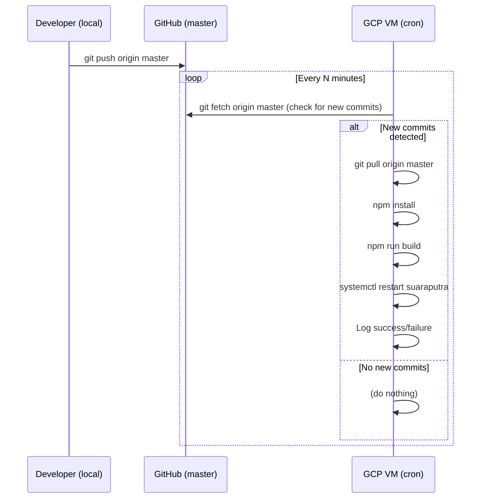

# CI/CD Auto-Deploy Plan — SuaraPutra

> Automatically pull, build, and restart the app on the GCP VM whenever `master` is updated.

## Status: 📋 Plan (not yet implemented)

---

## 1. Chosen Approach: Poll-Based Auto-Deploy

Instead of a webhook (which needs a stable public IP/hostname), the VM will **poll GitHub on a cron schedule** to detect new commits on `master`. When a new commit is found, it pulls, rebuilds, and restarts the systemd service.



### Why this approach?

| Factor | Webhook | Poll-based (chosen) |
|---|---|---|
| Needs static IP or domain | ✅ Yes | ❌ No |
| Needs open ports / firewall rules | ✅ Yes | ❌ No |
| Needs a listener process / web server | ✅ Yes | ❌ No |
| Deploy latency | Instant (~seconds) | Up to N minutes |
| Infra changes required | Promote IP or add DNS | **None** |
| Security surface | Webhook endpoint exposed | No new surface |

> [!NOTE]
> The only trade-off is a small delay (up to 2–5 minutes depending on the cron interval you choose). For this project, that's perfectly fine.

---

## 2. What We'll Create

We need **two files** deployed to the VM:

### File 1: `deploy/auto-deploy.sh` — The deploy script

A bash script that:

1. `cd /opt/suaraputra`
2. `git fetch origin master`
3. Compares `HEAD` vs `origin/master` — if same, exit early
4. `git pull origin master`
5. `npm install --production` (in case `package.json` changed)
6. `npm run build` (TypeScript → `dist/`)
7. `sudo systemctl restart suaraputra`
8. Logs the deployed commit hash and timestamp to a log file

Key design decisions:
- Uses a **lock file** (`/tmp/suaraputra-deploy.lock`) to prevent overlapping runs
- Logs to `/opt/suaraputra/data/deploy.log` for troubleshooting
- Exits silently and cleanly when there's nothing new (no spam in cron logs)
- Runs as the `suaraputra` user (with limited sudo for `systemctl restart` only)

### File 2: Cron job entry

A crontab entry for the `suaraputra` user that runs `auto-deploy.sh` every N minutes.

---

## 3. Implementation Steps

### Step 1 — Write the deploy script

Create `deploy/auto-deploy.sh` in the repo:

```
deploy/
├── suaraputra.service    ← (already exists)
└── auto-deploy.sh        ← NEW
```

The script will roughly look like:

```bash
#!/usr/bin/env bash
set -Eeuo pipefail

DEPLOY_DIR="/opt/suaraputra"
LOG_FILE="${DEPLOY_DIR}/data/deploy.log"
LOCK_FILE="/tmp/suaraputra-deploy.lock"
BRANCH="master"

# Prevent concurrent runs
exec 200>"${LOCK_FILE}"
flock -n 200 || { echo "Deploy already running, skipping." >> "${LOG_FILE}"; exit 0; }

cd "${DEPLOY_DIR}"

# Fetch latest from remote
git fetch origin "${BRANCH}" 2>>"${LOG_FILE}"

LOCAL=$(git rev-parse HEAD)
REMOTE=$(git rev-parse "origin/${BRANCH}")

if [[ "${LOCAL}" == "${REMOTE}" ]]; then
    exit 0  # Already up to date — silent exit
fi

echo "[$(date -Iseconds)] Deploying ${REMOTE} (was ${LOCAL})..." >> "${LOG_FILE}"

git pull origin "${BRANCH}" >> "${LOG_FILE}" 2>&1
npm install --production >> "${LOG_FILE}" 2>&1
npm run build >> "${LOG_FILE}" 2>&1
sudo systemctl restart suaraputra

echo "[$(date -Iseconds)] Deploy complete: $(git rev-parse --short HEAD)" >> "${LOG_FILE}"
```

### Step 2 — Grant limited sudo to the `suaraputra` user

The `suaraputra` user needs passwordless sudo **only** for restarting the service. We add a sudoers drop-in:

```
# /etc/sudoers.d/suaraputra-deploy
suaraputra ALL=(root) NOPASSWD: /usr/bin/systemctl restart suaraputra
```

> [!IMPORTANT]
> This is tightly scoped — the user can only restart this one service, nothing else.

### Step 3 — Set up Git credentials on the VM

Since the repo is public, `git pull` over HTTPS should work without credentials. We just need to make sure the remote is set to HTTPS:

```bash
cd /opt/suaraputra
git remote -v
# Should show: https://github.com/<org>/SuaraPutra_Smart_Multilingual_Broadcasting.git
```

> [!NOTE]
> If the remote is currently SSH-based (`git@github.com:...`), we'll switch it to HTTPS since the repo is public and no auth is needed for read-only pulls.

### Step 4 — Install the cron job

```bash
# As the suaraputra user (or via sudo):
crontab -e -u suaraputra

# Add this line (runs every 2 minutes):
*/2 * * * * /opt/suaraputra/deploy/auto-deploy.sh
```

The interval is configurable. Recommended options:

| Interval | Cron expression | Max deploy delay |
|---|---|---|
| Every 1 minute | `* * * * *` | 1 min |
| **Every 2 minutes** | `*/2 * * * *` | **2 min (recommended)** |
| Every 5 minutes | `*/5 * * * *` | 5 min |

### Step 5 — Test the full flow

1. SSH into the VM
2. Run the script manually once: `bash /opt/suaraputra/deploy/auto-deploy.sh`
3. Check the log: `tail -f /opt/suaraputra/data/deploy.log`
4. Push a small change to `master` from local
5. Wait for the cron to pick it up (or run manually)
6. Verify the service restarted: `sudo systemctl status suaraputra`

---

## 4. One-Time VM Setup Checklist

Run these commands **once** on the VM to set everything up:

```bash
# 1. Make sure git remote is HTTPS (public repo, no auth needed)
cd /opt/suaraputra
git remote set-url origin https://github.com/<your-org>/SuaraPutra_Smart_Multilingual_Broadcasting.git

# 2. Copy the deploy script and make it executable
cp deploy/auto-deploy.sh /opt/suaraputra/deploy/auto-deploy.sh
chmod +x /opt/suaraputra/deploy/auto-deploy.sh

# 3. Add the sudoers rule (as root)
echo 'suaraputra ALL=(root) NOPASSWD: /usr/bin/systemctl restart suaraputra' \
  | sudo tee /etc/sudoers.d/suaraputra-deploy
sudo chmod 440 /etc/sudoers.d/suaraputra-deploy

# 4. Install the cron job
(crontab -l -u suaraputra 2>/dev/null; echo '*/2 * * * * /opt/suaraputra/deploy/auto-deploy.sh') \
  | crontab -u suaraputra -

# 5. Create the log file
touch /opt/suaraputra/data/deploy.log
chown suaraputra:suaraputra /opt/suaraputra/data/deploy.log
```

---

## 5. Safety & Edge Cases

| Concern | How we handle it |
|---|---|
| Two cron runs overlap | `flock` lock file prevents concurrent execution |
| `npm install` fails | Script exits with error; service stays on the **old** working version |
| `npm run build` fails | Same — service stays on the old version; error is logged |
| VM reboots | Cron survives reboots; `suaraputra.service` is already `WantedBy=multi-user.target` |
| Disk space | `deploy.log` can be rotated with logrotate (optional future enhancement) |
| Partial pull / network error | `set -Eeuo pipefail` aborts the script on any failure |

> [!WARNING]
> The script does **not** roll back automatically on a failed build. If a build fails, the old `dist/` stays in place and the service keeps running the previous version. You'll see the error in `deploy.log` and can fix it by pushing a corrected commit.

---

## 6. Future Enhancements (Optional, Not In Scope Now)

These are things you might want later but are **not** part of this plan:

- **Notification on deploy** — Send a message (Telegram, Discord, email) when a deploy succeeds or fails
- **Rollback mechanism** — Keep the previous `dist/` as a backup and restore on build failure
- **Health check after restart** — Curl a health endpoint to confirm the service is actually running
- **Upgrade to webhook later** — If you ever get a static IP or domain, you can switch to instant deploys with a simple webhook listener
- **Log rotation** — Add a logrotate config for `deploy.log`
- **Skip `npm install` when no dependency changes** — Compare `package-lock.json` hash before and after pull to skip the slow `npm install` step when only source files changed

---

## 7. Summary

| What | Detail |
|---|---|
| **Trigger** | Cron every 2 minutes on the VM |
| **Detection** | `git fetch` + compare local HEAD vs `origin/master` |
| **Deploy steps** | `pull → npm install → build → systemctl restart` |
| **Files to create** | `deploy/auto-deploy.sh` (1 file) |
| **VM config** | 1 cron entry + 1 sudoers rule |
| **Downtime** | Only during `systemctl restart` (~2-5 seconds) |
| **Infra changes** | **None** — no ports, no IPs, no DNS |
